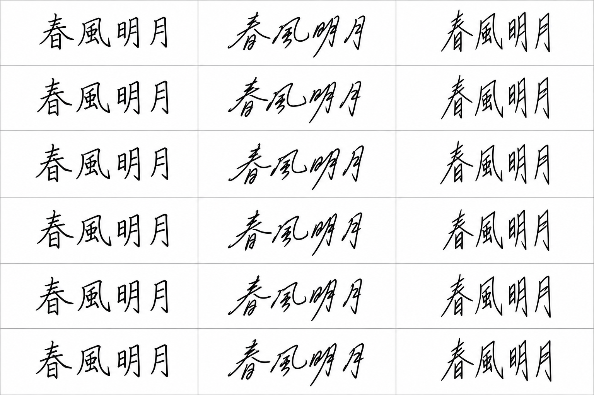

# GreyTheory

[English](README.md) | [繁體中文](README.zh-TW.md) | **日本語**

GreyTheory は、灰色予測、灰色関連分析（GRA）、PCA を使える Python ツールキットです。
時系列の予測、特徴量の絞り込み、スペクトルや測定データの比較に使えます。

| やりたいこと | 使う機能 |
| --- | --- |
| 次の数値を予測する | [GM(1,1)](#時系列予測) |
| 二段階のウィンドウ予測 | [Convolution](#convolution二段階のウィンドウ予測) |
| 特徴と目標値を比較する | [GRA](#灰色関連分析gra) |
| 次元を減らして成分を選ぶ | [GreyPCA](#pca-と特徴選択) |
| 大小の好ましい方向を揃えて評点を出す | [品質スコア](#品質スコア) |
| 軌跡や画像から特徴を作る | [特徴抽出](#軌跡画像ウィンドウ特徴) |
| PNG／JPG を読んで比較する | [画像ファイル](#画像ファイルを読み込む) |
| Bruker ファイルを読む | [SPX／BCF](#bruker-ファイルの読み込み) |
| 合成スペクトルと AI 筆跡を試す | [二つのデモ](#合成-xrf-と-ai-筆跡デモ) |

## まず動かす

Python 3.11 以降が必要です。ダウンロードまたは clone 後、プロジェクト内で実行します。

```bash
python3 run.py
```

> [!TIP]
> 初回に `.venv` を作り、依存パッケージを入れてサンプルを実行します。
> 次回も同じコマンドで使えます。環境の有効化は不要です。

自分のプログラムで使う場合は、その Python 環境でプロジェクト内からインストールします。

```bash
python -m pip install .
```

## 時系列予測

`fit` に観測値を渡し、`predict(2)` で次の二点を予測します。

```python
from greytheory import GM11

series = [223.3, 227.3, 230.5, 238.1, 242.9, 251.1]
model = GM11(background_mode="corrected").fit(series)
print(model.predict(2))
print(model.metrics)
```

三点以上のデータが必要です。二段階のウィンドウ予測は下の Convolution を参照してください。

係数は `model.coefficients`、計算の診断は `model.diagnostics` で確認できます。
`set_data` はバッチ処理用にデータを保存します。`reset()` は結果を消し、
`reset(clear_data=True)` はデータも消します。

<details>
<summary>背景値、正則化、誤差</summary>

`background_mode="corrected"` は `alpha * current + (1-alpha) * previous` を使います。
既定の `"legacy"` は両項に `alpha` を掛けます。`alpha=0.5` なら同じです。

最小二乗法で解き、`ridge_alpha` で正則化を指定できます。
`rank_policy="raise"` は係数を一意に推定できない場合にエラーを返します。
診断にはランク、条件数、残差が含まれます。

`horizon=0` は過去のデータだけを当てはめます。観測値がゼロなら相対誤差は `None` になりますが、
MAE と RMSE は使えます。`predict` は保存済みの結果を変更しません。

</details>

## Convolution：二段階のウィンドウ予測

`window_size` で convolution を有効にします。各窓の GM(1,1) で次の値を予測し、その結果を二段目の GM(1,1) に渡します。

**元の系列 → 各窓の予測 → 二段目の GM(1,1) → 将来の値**

```python
from greytheory import GM11

series = [223.3, 227.3, 230.5, 238.1, 242.9, 251.1]
model = GM11(window_size=4, stride=1, background_mode="corrected").fit(series)
print(model.predict(2))
```

| 設定 | 意味 |
| --- | --- |
| `window_size=4` | 一窓に四点。`None` は通常の GM11 |
| `stride=1` | 一点ずつ移動 |
| `predict(2)` | 将来の二点を予測 |
| `correction_mode="legacy"` | 既定の窓の誤差補正。`"none"` で無効化 |

二段階の予測には三つ以上の窓を用意します。上の六点、窓幅四、移動幅一なら三つの窓になります。
`coefficients` と `metrics` は最後の段の結果です。元の方式と同じく、最後の窓に末尾の余ったデータを含む場合があります。

通常の予測との比較を実行できます。

```bash
.venv/bin/python examples/convolution_forecast.py
```

出力例：

```text
Ordinary GM11, next two values: [256.5532, 263.1223]
Convolution GM11, next two values: [265.9278, 274.0119]
```

`GreyWindowFeatures` は PCA／GRA 向けに窓の特徴を作る機能で、二段目の予測は行いません。

## 複数要因のモデル

`GM0N` と `GM1N` は複数の要因と一つの目標値を扱います。各行が観測、各列が要因です。

```python
from greytheory import GM0N

factors = [[.75, .5], [1.22, 1], [.2, .7], [1, .66], [1, 1], [1, .5]]
targets = [1, 1, 1, 1, 1, 1]
model = GM0N().fit(factors, targets, feature_names=["factor_a", "factor_b"])
print(model.coefficients)
print(model.influence_degrees)
```

GM(1,N) は `GM1N().fit(factors, targets)` です。要因名は省略できます。
`influence_degrees` は係数の絶対値による順位なので、単位や共線性の影響を受けます。
目標との近さを比較する場合は GRA を使います。

## 灰色関連分析（GRA）

参照系列と比較する系列を渡します。選んだ正規化のもとで参照に近いほど、高いスコアになります。

```python
from greytheory.analysis import grey_relation

scores = grey_relation(
    reference=[0.2, 0.5, 0.8],
    candidates=[[0.2, 0.5, 0.8], [0.8, 0.1, 0.2]],
    rho=0.5,
    normalize="none",
)
print(scores)
```

`normalize` は `none`、`minmax`、`zscore`、`initial`、`mean` から選べます。
`greytheory.analysis` の `GreyGRA` を使い、`.score(...)` や `.rank(...)` を呼ぶこともできます。

候補の追加・削除でスコアや順位が変わる場合があります。スコアは灰色関連度で、因果や予測精度を示すものではありません。

<details>
<summary>GRA の式</summary>

絶対差 `Δ` から `(Δmin + rho*Δmax) / (Δ + rho*Δmax)` を計算し、加重平均を取ります。
`rho` は `(0, 1]`、重みは非負です。差の極値は同じ候補集合から求めます。
スコアが 1 でも、元の数値が完全に一致するとは限りません。

</details>

## PCA と特徴選択

`GreyFeatureSelector` は元の列を選びます。`GreyPCA` は次元を減らし、GRA で目標に近い成分を選びます。
以下は合成データの例です。

```python
import numpy as np
from sklearn.model_selection import train_test_split
from greytheory.analysis import GreyFeatureSelector, GreyPCA

random_generator = np.random.default_rng(7)
factors = random_generator.normal(size=(48, 6))
targets = factors[:, 0] + 0.05 * random_generator.normal(size=48)
train_factors, test_factors, train_targets, _ = train_test_split(
    factors, targets, random_state=7
)

selector = GreyFeatureSelector(k=2).fit(train_factors, train_targets)
selected_factors = selector.transform(test_factors)

analysis = GreyPCA(
    n_components=4, method="sparse", method_params={"alpha": 0.1},
    top_k=2, standardize=True,
).fit(train_factors, train_targets)
components = analysis.transform(test_factors)
print(analysis.selected_components)
print(analysis.component_scores)
```

`n_components` は分解の成分数、`top_k` は GRA が残す数です。
次元削減だけなら `fit(train_factors)` とし、目標値を省略します。
> [!IMPORTANT]
> **先に訓練・テストデータを分けます。**
> 変換の `fit` は訓練データで行い、テストデータには `transform` だけを使います。

### PCA を切り替える

`method` を変え、各手法の設定を `method_params` に渡します。

| `method` | 手法 | `method_params` の例 |
| --- | --- | --- |
| `"pca"`（既定） | 通常の PCA | `{"whiten": True}` |
| `"sparse"` | SparsePCA | `{"alpha": 0.1}` |
| `"kernel"` | KernelPCA | `{"kernel": "rbf", "gamma": 0.1}` |
| `"robust"` | PCP の低ランク行列から PCA 射影を作成 | `{"tol": 1e-6}` |
| `"robust_sparse"` | Huber／elastic-net RobustSparsePCA | `{"alpha": 0.1, "kappa": 1.0}` |
| `"adv"` | AdvPCA | `{"delta": 0.01, "max_iter": 1000}` |

AdvPCA に切り替える例です。

```python
analysis = GreyPCA(
    3, method="adv", method_params={"delta": 0.01, "max_iter": 1000},
    top_k=2, standardize=True,
).fit(train_factors, train_targets)
components = analysis.transform(test_factors)
print(analysis.reducer.converged)
print(analysis.reducer.inner_converged)
```

AdvPCA は外側と最終内側の両方の収束を確認してから結果を評価します。
手法の比較は [grey_pca_methods.py](examples/grey_pca_methods.py) を参照してください。

sklearn 互換モデルを渡すこともできます。この場合はモデル側で成分数を設定します。

```python
from sklearn.decomposition import IncrementalPCA

analysis = GreyPCA(
    estimator=IncrementalPCA(n_components=4, batch_size=12), top_k=2,
).fit(train_factors, train_targets)
```

モデルは `fit`、`transform`、sklearn clone に対応し、一観測一行の二次元密行列を返す必要があります。
`estimator` と `method`／`method_params` はどちらか一方を使います。

### 選んだ成分と順位を見る

`component_scores` が GRA スコア、`selected_components` がゼロ始まりの選択インデックスです。
出力は元の成分順を保ちます。スコアの高い順に見るには：

```python
valid = np.flatnonzero(np.isfinite(analysis.component_scores))
ranking = valid[np.argsort(-analysis.component_scores[valid], kind="stable")]
for index in ranking:
    print(f"PC{index + 1}", float(analysis.component_scores[index]))
```

元の列のスコアは `selector.scores` です。目標値がなければ `component_scores` は `None` です。
この選択は連続値の目標向けです。筆者 ID などのカテゴリには別の分類・照合モデルが必要です。

### 成分数を決める

通常の PCA は、残したい累積寄与率を小数で指定できます。例えば 85%：

```python
ordinary = GreyPCA(n_components=0.85, method="pca", standardize=True).fit(train_factors)
print(ordinary.n_components_fitted)
print(ordinary.explained_variance_ratio.sum())

report = analysis.reconstruction_report(train_factors, threshold=0.85)
print(report.prefix_coverage)
print(report.first_prefix_at_threshold)
print(report.selected_coverage)
```

小数の `n_components` は通常 PCA のみです。AdvPCA や SparsePCA は再構成カバレッジを確認します。
80–85% は出発点です。小さい分散にも品質の情報があり得るため、別のデータで予測性能を確認してください。

<details>
<summary>分解だけを使う場合とスペクトル PCA</summary>

以下は `greytheory.analysis` から読み込みます。GRA は自動で加わりません。

| 呼び出し | 用途 |
| --- | --- |
| `PCAAdapter(3, method="pca")` | 通常 PCA |
| `PCAAdapter(3, method="sparse", alpha=0.1)` | SparsePCA |
| `PCAAdapter(3, method="kernel", gamma=0.1)` | KernelPCA |
| `RobustPCA().fit(data)` | `low_rank` と `sparse` 行列を取得 |
| `RobustSparsePCA(3).fit(data)` | Huber／elastic-net の疎な射影 |
| `AdvPCA(3, delta=0.05).fit(data)` | AdvPCA の射影 |

以下は `greytheory.spectroscopy` から読み込みます。

| 呼び出し | 入力 |
| --- | --- |
| `PoissonPCA(3).fit_transform(counts)` | 非負の計数。近似的な分散安定化を使用 |
| `fit_mlpca(data, variances, n_components=3)` | 誤差は独立で、各要素に正の誤差分散が必要 |
| `fit_mnf(cube, n_components=3)` | 空間 × 空間 × バンド。隣接画素から雑音を推定 |

GRA と組み合わせる場合は `GreyPCA(estimator=PoissonPCA(3), standardize=False)` とします。
計数には、負値を作る標準化を適用しないでください。

</details>

<details>
<summary>成分の符号と再構成の注意点</summary>

`component_direction="either"` は同じ GRA 集合で正負を比べ、高い方を使います。
定数成分は除外され、`top_k=None` は評価可能な全成分を残します。
品質目標に符号を揃えるには `align_to_target=True` を指定します。同点ならエラーです。
物理的な単調性や、再学習による成分の交換・回転を保証するものではありません。

再構成カバレッジは `1 - SSE / SST` です。標準化したモデルでは標準化空間で計算し、
通常 PCA 以外では負値や非単調な変化もあり得ます。GRA 後の値は `selected_coverage` で確認します。
`first_prefix_at_threshold=None` は、評価した成分の組がどれも閾値に達しなかったことを示します。

KernelPCA の逆変換は近似です。`"robust"` は PCP の訓練結果から射影を作り、新しい行は再度 PCP 処理しません。
AdvPCA と PCP は目的が異なります。詳しくは[英語版](README.md#pca-and-feature-selection)を参照してください。

</details>

## 品質スコア

反りは小さく、せん断力は大きくしたい場合、まず 0–1 の値に揃えて加重 GRA スコアを計算します。

```python
from greytheory.analysis import rank_quality, grade_quality

quality = rank_quality(
    [[80, 10], [40, 20], [20, 25]],  # 行: サンプル、列: 反り・せん断力
    directions=["smaller", "larger"],
    bounds=[(0, 100), (0, 30)],      # 説明用の範囲。工程に合った値に変更
    weights=[0.5, 0.5],
)
print(quality.normalized_values)
print(quality.scores)
print(quality.ranking)  # [2, 1, 0]: よい順の行インデックス

new_benefits = quality.normalizer.transform([[30, 22]])
new_quality = grade_quality(new_benefits, weights=quality.weights, rho=quality.rho)
print(new_quality.scores)
```

`directions` は `larger`、`smaller`、`target` です。
膜厚を 100 に近づけたい場合は、`greytheory.analysis` の
`BenefitNormalizer(["target"], bounds=[(80, 120)], targets=[100])` に
`fit_transform` または `transform` を使います。

`bounds` は正規化の範囲です。省略時は訓練データの最小・最大を使います。

> [!NOTE]
> **ロット間では同じ範囲、重み、`rho` を使います。**
> 他のサンプルを追加しても、同じ行の品質スコアが変わらないようにします。

範囲外は既定でエラーです。`out_of_range="clip"` で境界に丸めても、
`normalizer.out_of_bounds(data)` で元の逸脱を確認できます。

> [!WARNING]
> **品質スコアは歩留まりや合否を示しません。**
> 設定した好みに沿った評点です。必須規格は別に確認してください。

元の列を大きいほどよい値に揃えても、すべての主成分が同じ性質になるわけではありません。

工程の予測例は [semiconductor_adv_quality.py](examples/semiconductor_adv_quality.py) です。
工程特徴と品質目標を分け、ロットで分割して AdvPCA／GRA＋Ridge と平均値ベースラインを比較します。
目標の算出に使った反り・せん断力を、その目標を予測する入力へ戻さないでください。

<details>
<summary>スコアの式と入力チェック</summary>

**計算方法**

`grade_quality` は各指標の係数を求め、加重平均を取ります。

```text
coefficient = rho / (1 - benefit + rho)
score       = weighted_mean(coefficients)
```

| 設定 | 値 |
| --- | --- |
| 理想系列 | すべて 1 |
| 差の最小値／最大値 | 0／1 に固定 |
| 集約方法 | 加重平均。指標間の補償は可能 |

`grey_relation` は候補集合から差の極値を求めます。
NIST desirability は幾何平均なので、計算方法が異なります。

**入力チェック**

| 項目 | 条件 |
| --- | --- |
| 数値 | NaN・無限大を含まない |
| 列 | 数、方向、名前、順序が一致 |
| 定数列 | 有効な正規化範囲を指定 |
| `target` | 上下限の内側。区分線形のピークを使用 |
| 重み | 非負で、少なくとも一つは正 |

この正規化と AdvPCA の半径 `delta` は別の設定です。

</details>

## 軌跡・画像・ウィンドウ特徴

次の流れでモデルにつなげられます。

**数値データ → 軌跡／画像特徴 → Grey ウィンドウ特徴 → PCA／GRA → 回帰や距離比較**

| 入力 | 形式 | 使うもの |
| --- | --- | --- |
| スペクトル・一次元系列 | `(サンプル数, 点数)` | `GreyWindowFeatures`。先にエネルギー軸を揃える |
| 二次元以上の軌跡 | 各要素が `(点数, 次元数)` の list | `TrajectoryFeatures` → `GreyWindowFeatures` |
| グレー・多チャネル画像 | `(サンプル数, 高さ, 幅[, チャネル数])` | `ImagePatchFeatures` → `GreyWindowFeatures` |

時刻とストローク情報を持つ二次元軌跡の例です。三次元、五次元も同じクラスで扱えます。

```python
from greytheory.features import Trajectory, TrajectoryFeatures, GreyWindowFeatures

path = Trajectory(
    points=[[0, 0], [1, 1], [2, 1], [10, 10], [11, 10], [12, 11]],
    timestamps=[0, 0.5, 1, 3, 3.5, 4],
    stroke_ids=[0, 0, 0, 1, 1, 1],
)
sequences = TrajectoryFeatures(n_points=16, include_time=True).fit_transform([path])
windows = GreyWindowFeatures(window_size=8, stride=4, boundary_channel=-1)
features = windows.fit_transform(sequences)
print(features.shape)

paths_3d = [[[0, 0, 0], [1, 2, 1], [2, 2, 3]]]
sequences_3d = TrajectoryFeatures(n_points=16).fit_transform(paths_3d)
paths_5d = [[[0, 0, 0, 0, 0], [1, 2, 1, 3, 2], [2, 2, 3, 4, 5]]]
sequences_5d = TrajectoryFeatures(n_points=16).fit_transform(paths_5d)
```

画像ファイルからの手順は、下の「画像ファイルを読み込む」を参照してください。

回帰を加える場合は sklearn Pipeline を使えます。
`train_paths` と `test_paths` は `Trajectory` の list、`train_targets` は各訓練軌跡に対応する連続値です。

```python
from sklearn.linear_model import Ridge
from sklearn.pipeline import Pipeline
from greytheory.analysis import GreyPCA

model = Pipeline([
    ("trajectory", TrajectoryFeatures(n_points=32, include_time=True)),
    ("windows", GreyWindowFeatures(8, stride=4, boundary_channel=-1)),
    ("reducer", GreyPCA(4, top_k=2, standardize=True)),
    ("model", Ridge(alpha=1)),
])
model.fit(train_paths, train_targets)
predictions = model.predict(test_paths)
```

実行例は [grey_feature_pipeline.py](examples/grey_feature_pipeline.py) です。
筆者照合や補彩の検出には、この特徴に加えて専用モデルと検証データが必要です。

### 画像ファイルを読み込む

最初に画像用の依存パッケージを入れます。

```bash
.venv/bin/python -m pip install -e ".[images]"
```

参照画像を三枚以上と、比較したい画像を一枚用意します。配置例です。

```text
test_data/images/
├── reference/
│   ├── sample_a.png
│   ├── sample_b.jpg
│   └── sample_c.png
└── query.png
```

`load_images` は一つのパスまたはパスの list を受け取り、0–1 の RGB 配列を返します。
PNG／JPG を読み、問い合わせ画像に近い順に並べる例です。

```python
from pathlib import Path
import numpy as np
from sklearn.metrics import pairwise_distances
from sklearn.pipeline import Pipeline
from greytheory.io import load_images
from greytheory.features import ImagePatchFeatures, GreyWindowFeatures
from greytheory.analysis import GreyPCA

reference_paths = sorted(
    path for path in Path("test_data/images/reference").iterdir()
    if path.is_file() and path.suffix.lower() in {".png", ".jpg", ".jpeg"}
)
reference_images = load_images(reference_paths, size=(128, 128))
query_image = load_images("test_data/images/query.png", size=(128, 128))

pipeline = Pipeline([
    ("patches", ImagePatchFeatures(grid_shape=(4, 8))),
    ("windows", GreyWindowFeatures(8, stride=8, boundary_channel=-1)),
    ("pca", GreyPCA(2, standardize=True)),
])
reference_components = pipeline.fit_transform(reference_images)
query_components = pipeline.transform(query_image)
distances = pairwise_distances(query_components, reference_components)[0]
for index in np.argsort(distances, kind="stable"):
    print(reference_paths[index].name, float(distances[index]))
```

PCA 特徴空間の距離が小さいほど近い画像です。参照だけで学習し、問い合わせ画像には変換だけを使います。
この距離だけで筆者、真贋、補彩を判定することはできません。

`size=(128, 128)` は幅・高さで、縦横比を保ち白い余白を追加します。省略時は全画像を同じサイズに揃えます。
EXIF の方向と透明部分の白背景処理も行います。グレー画像は `mode="L"` です。
切り出す領域と位置は先に揃えてください。高ビット深度の測定値は、この表示画像用の変換を通さず数値配列で扱います。

直接実行もできます。最初のコマンドはデモ PNG を作り、次のコマンドは自分の画像を読みます。

```bash
.venv/bin/python examples/image_files.py

.venv/bin/python examples/image_files.py \
  --references test_data/images/reference \
  --query test_data/images/query.png \
  --size 128 128
```

結果は既定で `artifacts/image_files/` に出力します。

| ファイル | 内容 |
| --- | --- |
| `features.csv` | 画像ごとの Grey ウィンドウ特徴 |
| `components.csv` | PCA 座標 |
| `ranking.csv` | 参照画像との距離と順位 |

実行コード：[image_files.py](examples/image_files.py)。

<details>
<summary>入力条件</summary>

軌跡は各ストロークを再標本化します。`include_time=True` では昇順の時刻が必要で、速度も計算します。
各ストロークは二点以上、`n_points` はストローク数の二倍以上にします。ペンを離した区間は距離・速度に含めません。
`center=True` は始点を除き、`scale=False` は元の尺度を保ちます。時刻や筆圧は空間座標に混ぜません。

Grey ウィンドウは GM 係数や統計量を取り出し、未来予測は行いません。
三点未満の断片は係数がゼロになるため、`gm_coverage` と `gm_full_rank_coverage` も確認してください。
`boundary_channel=-1` で境界をまたぐ計算を避け、`stride` は窓幅以下にします。

画像は数値配列で渡します。OCR や文字分割は含まず、静止画像から実際の速度・筆圧は得られません。
詳しい単位や出力項目は[英語版](README.md#trajectory-image-and-window-features)を参照してください。

</details>

## Bruker ファイルの読み込み

```python
from greytheory.io.bruker import read_bcf, read_spx

spectrum = read_spx("reference.spx")
image = read_bcf("scan.bcf", lazy=True)
counts = image.get_pixel(y=0, x=0, detector=0)
energy_keV = image.energy_axes[0]
roi = image.get_spectra((0, 0, 2, 2), detector=0)
```

SPX は計数、メタデータ、ファイル内のエネルギー校正を読みます。BCF は検出器ごとの校正を保持します。
ROI は上限を含まない `(y0, x0, y1, x1)`、計数は `uint64` です。

BCF は未圧縮 SFS 内の索引付き instructively packed 形式に対応しています。
他の符号化、外部圧縮、BCF v2 は未対応です。エネルギー軸が異なる場合は `sum_detectors` で合算できません。
手元のファイルでは、装置ソフトの結果と照合してください。

## 工程・スペクトル用ツール

| モジュール | 機能 |
| --- | --- |
| `greytheory.semiconductor` | PLS 品質回帰、動的／多元 PCA 監視、GRA 順位、Latin-hypercube サンプリング、GP 期待改善量の候補点 |
| `greytheory.spectroscopy` | AsLS 基線補正、NMF、MCR-ALS、MNF、Poisson PCA、重み付き低ランク近似、X 線情報、固定ピーク位置のフィッティング |

例：[合成スペクトル](examples/hyperspectral_gra_pca.py)、[製造ロットでの検証](examples/semiconductor_quality.py)、
[AdvPCA 品質予測](examples/semiconductor_adv_quality.py)。
XRF ピークの強度を濃度へ換算するには、装置、標準試料、マトリックスの校正が必要です。

## バッチ処理

同じモデルに別のデータを入れて追加できます。`ModelQueue` は追加時に深いコピーを保存します。

```python
from greytheory import GM11, ModelQueue

if __name__ == "__main__":
    queue = ModelQueue()
    model = GM11(background_mode="corrected")
    for series in ([2, 3, 4, 5, 6], [3, 4, 6, 8, 11]):
        queue.append(model.set_data(series))
    results = queue.run(workers=2)
    print([item.predict(2) for item in results])
```

`queue.run()` の既定は逐次実行です。`workers=2` で二つのプロセスを使い、結果は入力順で返します。
GM0N、GM1N、GM11 を混ぜられます。既存のモデル list には `run_models(models, workers=2)` も使えます。
プロセスを使う場合は `if __name__ == "__main__":` を残してください。

<details>
<summary>コピーとキューの更新</summary>

作成、追加、置換時にモデルを深くコピーします。`queue[0]` は保存済みのモデルを返すため、その場で編集できます。
全件成功してからキューを更新します。`inplace=False` は元のキューを残し、計算済みのコピーを返します。

</details>

## 合成 XRF と AI 筆跡デモ

[合成入力と分析結果](examples/results/synthetic_demos/)を同梱しています。ダウンロード後、
`examples/results/synthetic_demos/index.html` をブラウザーで開けば、Python なしで報告を見られます。
GitHub 上では HTML を直接表示できません。画像と CSV は下のリンクから確認できます。

再実行する場合は、プロジェクトのディレクトリで次を実行します（macOS／Linux）。

```bash
python3 -m venv .venv
.venv/bin/python -m pip install -e ".[demos]"
.venv/bin/python examples/synthetic_demos.py
```

Windows では `.venv/bin/python` を `.venv\Scripts\python.exe` に置き換えてください。

| デモ | 入力・分析 | 出力 |
| --- | --- | --- |
| 合成 XRF | 6×6 の四枚のマップ、1024 チャネルの 144 スペクトル。Ca／Fe／Cu／Zn の既知の混合重みと Poisson 雑音 | スペクトル、エネルギー GRA 順位、未使用の模擬マップでの PCA／GreyPCA 予測比較 |
| AI 筆跡の形状 | 春風明月の三つの指定スタイル、18 セル。参照 12、問い合わせ 6 | PCA／Grey ウィンドウ＋PCA の距離、座標、特徴 CSV |

再実行の結果は `artifacts/synthetic_demos/` に保存されます。その中の `index.html` を開いてください。
片方だけなら、スクリプトに `--demo xrf` または `--demo handwriting` を付けます。

| 確認する内容 | 同梱ファイル |
| --- | --- |
| 光譜のカウント、エネルギー軸、合成の正解値 | [spectra.csv](examples/results/synthetic_demos/xrf/spectra.csv)、[samples.csv](examples/results/synthetic_demos/xrf/samples.csv)。`emsa/` の MSA は一つにつき一スペクトル |
| エネルギー順位と予測の比較 | [energy_ranking.csv](examples/results/synthetic_demos/xrf/energy_ranking.csv)、[predictions.csv](examples/results/synthetic_demos/xrf/predictions.csv) |
| 筆跡の照会結果と全順位 | [queries.csv](examples/results/synthetic_demos/handwriting/queries.csv)、[ranking.csv](examples/results/synthetic_demos/handwriting/ranking.csv) |

同梱結果の更新には `.venv/bin/python examples/synthetic_demos.py --output examples/results/synthetic_demos` を使います。

関数からも使えます。

```python
from greytheory.demos import run_xrf_demo, run_handwriting_demo

xrf = run_xrf_demo("artifacts/synthetic_demos/xrf", seed=7)
handwriting = run_handwriting_demo("artifacts/synthetic_demos/handwriting")
print(xrf["report"])
print(handwriting["report"])
```

XRF は `emsa/*.msa`、`spx/*.spx`、`spectra.csv`、`dataset.npz` を出力します。
[Bruker は EMSA 交換を案内しています](https://www.bruker.com/it/products-and-solutions/elemental-analyzers/eds-wds-ebsd-SEM-Micro-XRF/software-esprit-family/esprit-reporting-and-data-management.html)が、実際の M4／ESPRIT への読み込みは別途確認が必要です。
SPX は本プロジェクトの最小読取り例です。混合重みは校正済みの元素 wt% ではありません。

筆跡は imagegen の生成画像で、[プロンプト](greytheory/demos/assets/handwriting_ai_sheet.json)も同梱しています。
ラベルは指定した形状スタイルで、実際の筆者ではありません。同じ生成ページ内の比較なので、実在の筆者の照合精度は示しません。
Grey は窓特徴の抽出です。スタイル ID を連続値の GRA 目標にはしません。

<details>
<summary>合成光譜と AI 筆跡の結果を見る</summary>





</details>

## 開発とテスト

```bash
python -m pip install -e . -r requirements-dev.txt
python -m pytest -q
python -m build
```

テストデータは生成または同梱済みで、別途ダウンロードは不要です。
`scripts/verify_full_install.py` でインストール後の API を確認できます。
サンプルの合成データは手順の説明用で、工程・化学・鑑識の精度検証ではありません。

GitHub 用のソース ZIP は `python3 scripts/package_github.py` で作成できます。
`artifacts/github_upload/` に保存され、ソースと合成結果を含みます。ローカル環境、キャッシュ、外部の装置データは含みません。

測定記録は [benchmarks/results](benchmarks/results/) にあります。
[コア比較](benchmarks/compare_core.py)と[降次元比較](benchmarks/compare_decomposition.py)を再実行できます。
時間の記録は macOS arm64 の値で、環境によって変わります。
従来の `GreyTheory`、`GreyGM*`、`add_pattern`／`add_patterns`、`grey.run.gm*` も使えます。

## ライセンス

[MIT](LICENSE)。依存パッケージには各ライセンスが適用されます。[Third-party notices](THIRD_PARTY_NOTICES.md) を参照してください。

## 参考文献と実装

詳しい文献一覧は[英語版](README.md#references)または[繁體中文版](README.zh-TW.md#參考文獻與實作來源)を参照してください。

- Liu & Lin (2011), [Grey Systems: Theory and Applications](https://doi.org/10.1007/978-3-642-16158-2).
- Candès et al. (2011), [Robust Principal Component Analysis?](https://doi.org/10.1145/1970392.1970395).
- Erichson et al. (2020), [Sparse Principal Component Analysis via Variable Projection](https://arxiv.org/abs/1804.00341).
- Vävinggren et al. (2026), [A Robust Optimization Approach to Sparse Principal Component Analysis](https://arxiv.org/abs/2606.03553).
- Camp (2019), [pyMCR / MCR-AR](https://doi.org/10.6028/jres.124.018).
- [scikit-learn](https://scikit-learn.org/stable/modules/decomposition.html)、[Spectral Python](https://www.spectralpython.net/algorithms.html)、[pybaselines](https://pybaselines.readthedocs.io/en/latest/algorithms/whittaker.html)。
- NIST/SEMATECH. [Multiple responses: the desirability approach](https://www.itl.nist.gov/div898/handbook/pri/section5/pri5322.htm)。方向と目標設定の参考。GRA の加重平均は幾何平均 desirability と異なります。

- Pillow. [Image.open](https://pillow.readthedocs.io/en/stable/reference/Image.html#PIL.Image.open) と [ImageOps](https://pillow.readthedocs.io/en/stable/reference/ImageOps.html)。読込み、EXIF、余白処理。`images` extra でインストールします。
