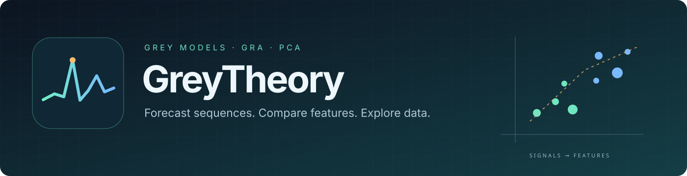
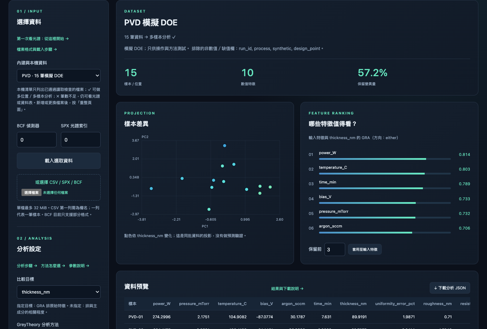

# GreyTheory

[English](README.md) | [繁體中文](README.zh-TW.md) | **日本語**

[](pyproject.toml)
[](LICENSE)
[](https://github.com/Kalvar/python-GreyTheory/actions/workflows/ci.yml)



<p align="center"><strong>Python で灰色予測・特徴比較・PCA を使う。</strong></p>
<p align="center"><a href="docs/README.ja.md">Documentation</a> · <a href="#quick-start">クイックスタート</a> · <a href="docs/README.ja.md#workbench">操作画面</a> · <a href="benchmarks/results/">ベンチマーク</a></p>

時系列を予測し、目標と関連する特徴を比較し、光スペクトルや工程データを整理できます。Python から使うか、付属の HTML 画面で試せます。

## できること

- **Grey + PCA の統合分析**：`GreyPCA` は 6 種類の PCA と GRA による主成分選択を組み合わせます。PCA で試料間の違いを整理し、参照する目標があれば GRA で関連する成分を評価・選択します。スペクトル・画像・軌跡には、PCA の前に Grey 窓特徴を加えて局所的な変化も扱えます。
- **予測**：GM11 と二段階 Convolution。有序の多変量データは GM0N／GM1N。
- **比較**：GRA 特徴順位と、望大／望小／目標値を指定する品質評価。
- **特徴の整理**：6 種類の PCA、PoissonPCA、Grey 窓、画像、多次元軌跡。

<a id="quick-start"></a>

## クイックスタート

**Python 3.11 以上**が必要です。ソースをダウンロードまたは clone して実行します。

```bash
python3 run.py
```

> [!TIP]
> 初回は `.venv` と依存パッケージを準備します。Windows は `python3` を `python` に置き換えてください。

### Python から使う

自分のプログラムの Python 環境にインストールします。

```bash
python -m pip install .
```

```python
from greytheory import GM11

series = [223.3, 227.3, 230.5, 238.1, 242.9, 251.1]
model = GM11(background_mode="corrected").fit(series)
print(model.predict(2))
```

## PCA を選ぶ

`GreyPCA` の `method` を指定します。画面でも同じ方法を選べます。

```python
from greytheory.analysis import GreyPCA

features = [[1.0, 2.0, 0.8], [1.5, 2.4, 1.2],
            [2.0, 3.1, 1.1], [2.5, 3.4, 1.8]]
model = GreyPCA(n_components=2, method="pca", standardize=True)
components = model.fit_transform(features)
print(components)
```

| 方法 | 試す場面 |
| --- | --- |
| `"pca"` | 標準の線形投影。まずはこれから。 |
| `"sparse"` | 疎な成分係数を使いたいとき。 |
| `"kernel"` | 非線形の構造を調べるとき。 |
| `"robust"` | PCP の低ランク分解後に投影。 |
| `"robust_sparse"` | 頑健性と疎な符号化を組み合わせる。 |
| `"adv"` | 指定した摂動条件での投影を調べる。 |

非負の元計数には PoissonPCA もあります。パラメーター、成分選択、GRA と PCA の順位の違いは詳細ガイドを参照してください。 [→ GreyPCA](docs/guide.ja.md#pca-と特徴選択)

## 操作画面で試す

`workbench` は GreyTheory の分析画面を開きます。スペクトル、DOE データ、筆跡画像を読み込み、手法とパラメーターを選び、グラフや特徴の順位を確認できます。

```bash
python3 run.py workbench
```

初回は `.venv` を作成し、分析・画面用の依存パッケージをインストールします。次回からは同じ環境を使います。分析はローカルで実行され、サーバーは不要です。

付属 HTML を直接開くと、事前計算した結果の**オフラインプレビュー**を表示します。新しい設定での計算には上記コマンドか要求／結果 JSON 交換を使います。

[HTML](examples/workbench/index.html) · [スクリーンショット付きの操作説明](docs/README.ja.md#workbench)



*PVD の模擬実験 15 件。左は試料差の投影、右は目標に対する工程入力の比較です。*

デモの入力と結果は [data/demo/](data/demo/README.md) にまとめています。[データ選択ページ](data/demo/index.html)でファイルと操作手順を確認できます。

### その他のデモ

配送、ドライバー配車、美術品の光スペクトル差、注文予測、多次元軌跡、光スペクトル・半導体ツールを試せます。画像ページは AI 筆跡や自分の画像も比較できます。

[スクリーンショット付きの操作説明](docs/README.ja.md#gallery) · [PVD CSV](data/demo/doe/pvd_15.csv) · [CVD CSV](data/demo/doe/cvd_15.csv)

> [!NOTE]
> デモは合成データで、実務精度を示しません。配送と配車は専用の最適化を使い、Grey は選好を評価します。画像距離は作者を特定せず、美術品の異常は調査の手掛かりです。

## Documentation

| ガイド | 内容 |
| --- | --- |
| [スクリーンショット付きの操作説明](docs/README.ja.md) | インストール、プレビュー、即時計算、ファイル交換 |
| [GreyPCA](docs/guide.ja.md#pca-と特徴選択) | 6 種類の PCA とパラメーター、成分選択 |
| [Images / trajectories](docs/guide.ja.md#画像ファイルを読み込む) | 画像の読み込み、特徴、比較 |
| [Bruker](docs/guide.ja.md#bruker-ファイルの読み込み) | SPX／BCF と検出器の校正 |
| [使い方と API](docs/guide.ja.md) | 予測、GRA、品質、バッチ、参考文献 |

## 開発とテスト

```bash
python -m pip install -e . -r requirements-dev.txt
python -m pytest -q
python -m build
```

[Benchmarks](benchmarks/results/) · [Issues](https://github.com/Kalvar/python-GreyTheory/issues)

## ライセンス

[MIT](LICENSE) · [Third-party notices](THIRD_PARTY_NOTICES.md)

## 参考文献と実装

<details>
<summary>Grey と PCA の主要文献</summary>

Grey、PCA、実装済みのロバスト手法の主要文献です。スペクトル・工程分析の出典は[詳細ガイド](docs/guide.ja.md#参考文献と実装)を参照してください。

1. Deng, J. L. (1982). [Control problems of grey systems](https://doi.org/10.1016/S0167-6911(82)80025-X). *Systems & Control Letters*, 1(5), 288–294.
2. Liu, S. & Lin, Y. (2011). [Grey Systems: Theory and Applications](https://doi.org/10.1007/978-3-642-16158-2). Springer. Grey modelling and relational analysis.
3. Kayacan, E., Ulutas, B. & Kaynak, O. (2010). [Grey system theory-based models in time series prediction](https://doi.org/10.1016/j.eswa.2009.07.064). *Expert Systems with Applications*, 37(2), 1784–1789.
4. Jolliffe, I. T. & Cadima, J. (2016). [Principal component analysis: a review and recent developments](https://doi.org/10.1098/rsta.2015.0202). *Philosophical Transactions A*, 374, 20150202.
5. Candès, E. J., Li, X., Ma, Y. & Wright, J. (2011). [Robust Principal Component Analysis?](https://doi.org/10.1145/1970392.1970395). *Journal of the ACM*, 58(3), Article 11. Principal Component Pursuit.
6. Lin, Z., Chen, M. & Ma, Y. (2010). [The Augmented Lagrange Multiplier Method for Exact Recovery of Corrupted Low-Rank Matrices](https://arxiv.org/abs/1009.5055). Inexact ALM solver for PCP.
7. Erichson, N. B. et al. (2020). [Sparse Principal Component Analysis via Variable Projection](https://doi.org/10.1137/18M1211350), [author manuscript](https://arxiv.org/abs/1804.00341). *SIAM Journal on Applied Mathematics*, 80(2), 977–1002. Robust sparse model: equation (17), Algorithm 2.
8. Vävinggren, D. et al. (2026). [A Robust Optimization Approach to Sparse Principal Component Analysis](https://arxiv.org/abs/2606.03553). AdvPCA: Algorithms 1–2 and Appendix A.3.

</details>
