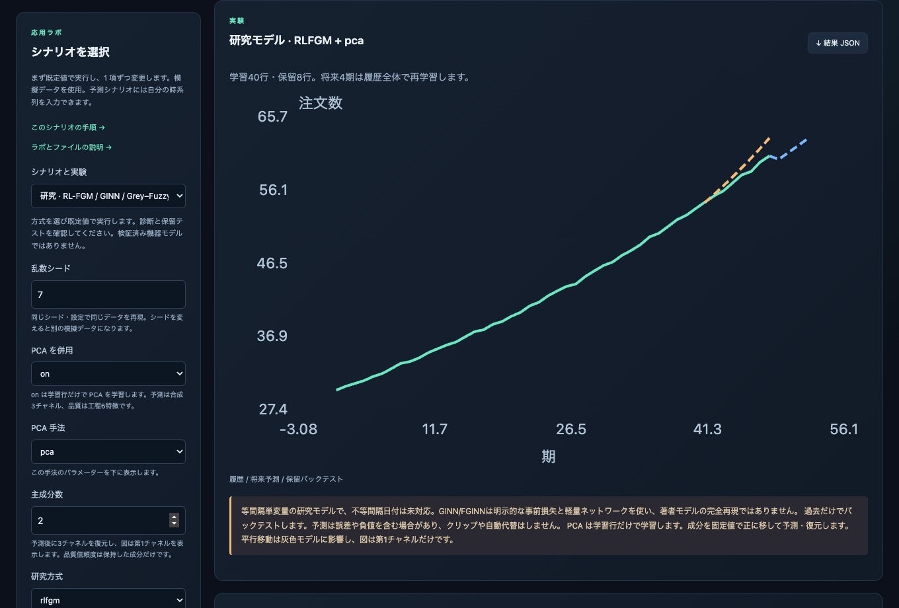
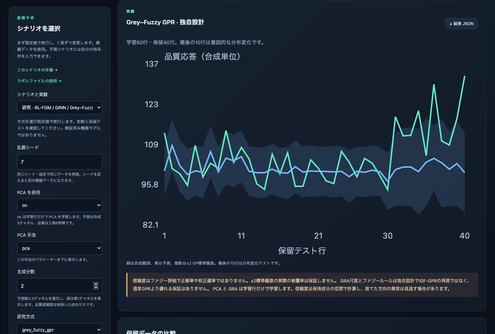
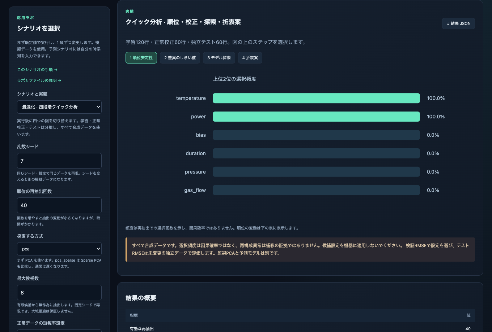
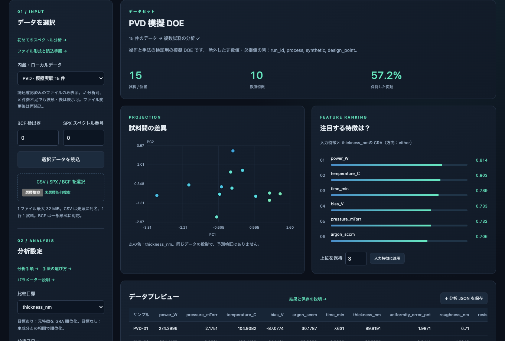
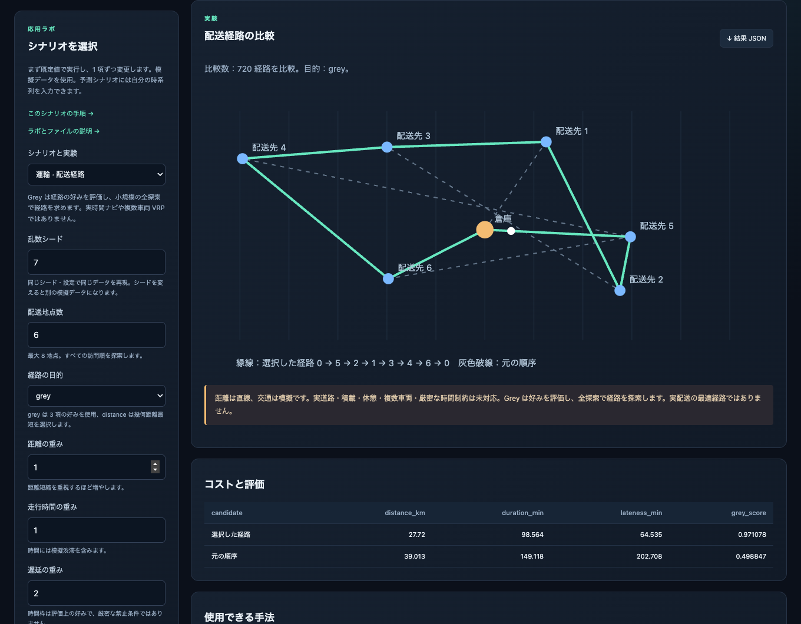
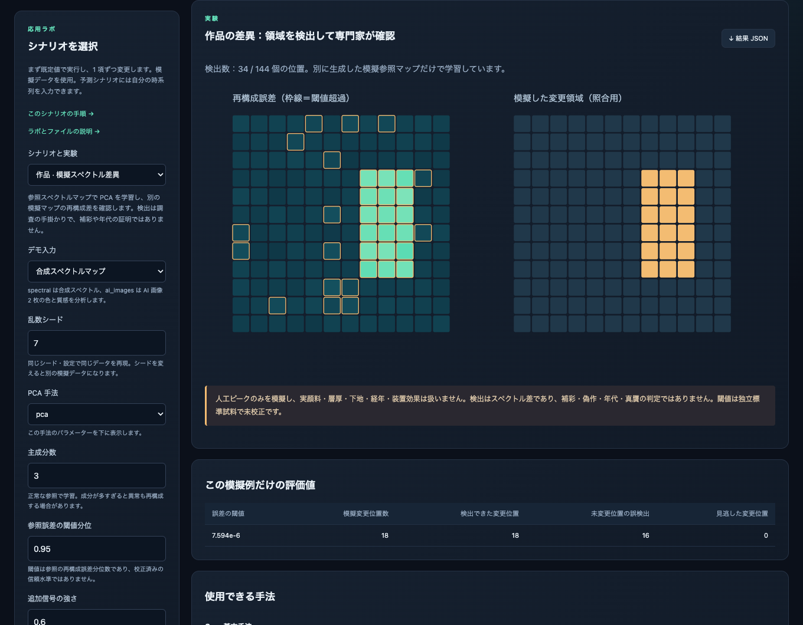
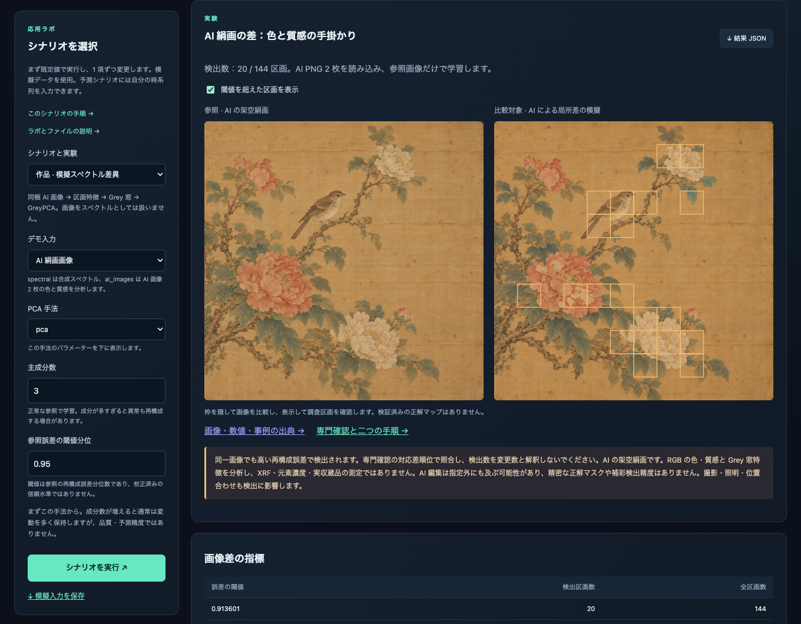
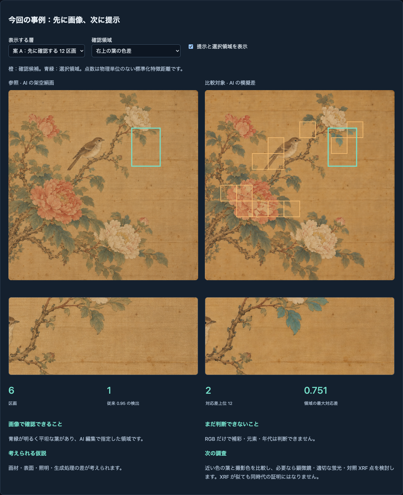
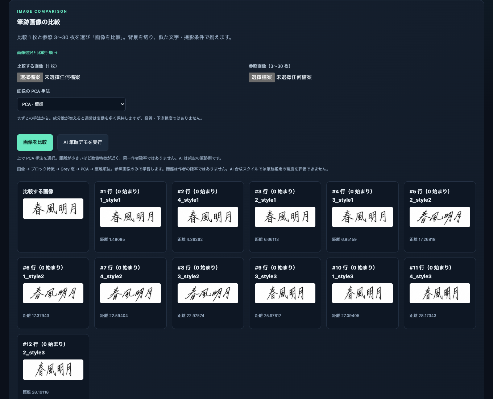

# Documentation

[English](README.md) | [繁體中文](README.zh-TW.md) | **日本語**

[使い方と API](guide.ja.md) · [GreyTheory](../README.ja.md)

画面の操作はこのページ、Python の例・パラメーター・参考文献は詳細ガイドを参照してください。

[順位安定性・しきい値校正・GreyPCA 探索・パレート候補](guide.ja.md#順位安定性しきい値校正最適化)を Python から利用できます。`python3 run.py optimize` で四段階の例を実行し、`artifacts/optimization/report.json` に保存します。GUI の「応用ラボ → 最適化 · 四段階クイック分析」からも利用できます。

> [!NOTE]
> コマンドはプロジェクトのルートで実行します。画像には合成データだけを使い、個人や私有 Bruker データは含みません。

デモ入力と結果は [data/demo/](../data/demo/README.md) にまとめています。[データ選択ページ](../data/demo/index.html)で各ファイルと操作を確認できます。

ローカル一覧には読込確認済みのファイルだけを表示します。読み込めないファイルと理由は別の折りたたみ欄に表示します。複数位置・試料の分析が可能なら ✓、3 件未満なら ✗ と表示します。単一スペクトルのグラフは表示できます。ファイルを追加・変更したら画面を再読込してください。

## 研究モデルのデモ

`python3 run.py workbench` を実行し、**応用ラボ → 研究モデル**で方式を選んで実行します。合成データなのでファイル選択は不要です。

- **rlfgm**：まずauto次数で実行し、履歴・保留8行・将来4期を確認します。次数は学習内の時系列保留区間だけで選びます。
- **ginn／fginn**：窓3・事前重み0.1で始め、収束を確認します。FGINNのorder=beta=1は通常の灰色事前モデルで、重み0は通常ネットワークです。
- **grey_fuzzy_gpr**：同じ保留データで通常GPと比較します。緑が合成観測、青が予測、帯は±2 GP標準偏差で被覆保証ではありません。最後10行は分布変化。ファジー評価は正解確率ではありません。

直接HTMLには各方式の既定結果があり、設定変更はPythonか要求／結果交換で計算します。結果JSONは診断と警告を保存します。[数式と実装差](guide.ja.md#研究モデルrl-fgmginngreyfuzzy-gpr)でRLの核・ネットワーク工学版・独自GPRを区別しています。全基準比較は `python3 run.py research`。新方式が劣る結果も保存します。




GUI は研究モデル → PCA を併用：on。予測成分は学習データから決めた正の平行移動を使い、灰色モデルの結果に影響します。品質信頼度は保持成分だけです。

## 四段階の最適化デモ

`python3 run.py workbench` を実行し、**応用ラボ → 最適化 · 四段階クイック分析**を選んで実行します。ファイル選択は不要です。

1. **順位安定性**：上位2位の選択頻度を確認します。再抽出を増やすと時間がかかります。
2. **差異のしきい値**：橙点は独立した正常60行で校正したしきい値を超え、紫枠は模擬シフトです。シフト0で再実行し正常誤報を確認します。
3. **モデル探索**：候補の検証RMSEを比較します。未変更の独立テストRMSEは概要に別記します。
4. **折衷案**：橙点は品質損失と費用のパレート候補です。費用上限を下げると不適合候補が灰色になります。

四つのボタンは再計算せず図を切り替えます。左の設定変更にはPythonが必要です。結果JSONで設定・試行・分析全体を保存できます。学習120行・正常校正60行・テスト60行で、すべて合成データです。新しいアップロード欄はありません。直接HTMLではPythonで計算済みの既定結果を表示します。変更設定は要求の出力／結果の読み込みで実行できます。




<a id="workbench"></a>

## 操作画面を開く

### 1. ブラウザーでプレビュー

[examples/workbench/index.html](../examples/workbench/index.html)

付属 HTML を直接開くと内蔵例を表示します。インストールや server は不要です。設定変更は Python 計算が必要であることを画面に表示します。

### 2. Python で即時計算

```bash
python3 run.py workbench
```

`workbench` は GreyTheory の分析画面を開きます。データの読込、手法とパラメーターの選択、分析、グラフや特徴順位の確認ができます。

初回は `.venv` を作成し、分析・画面用の依存パッケージをインストールします。次回からは同じ環境を使います。分析はローカルで実行され、サーバーは不要です。

- **スペクトル／DOE**：データを読み込み、Grey、GRA、PCA などを選び、パラメーターを調整して実行します。
- **筆跡画像**：比較画像と参照画像を読み込み、特徴距離の順位を確認します。
- **内蔵デモ**：合成データで操作を試してから、自分のデータに切り替えられます。

## PVD／CVD：読込・目標選択・実行

工程を選んで読み込み、thickness_nm などの目標を指定します。投影と GRA 順位を見て、上位の特徴を選び即時モードで再実行できます。各工程は合成実験 15 件です。

右上の言語選択で English・繁體中文・日本語を切り替えます。入力、設定、結果は保持されます。



[CSV: PVD](../data/demo/doe/pvd_15.csv) · [CSV: CVD](../data/demo/doe/cvd_15.csv) · [Data manifest](../data/demo/doe/manifest.json)

<a id="gallery"></a>

## デモとスクリーンショット

### 配送経路

3–8 地点と距離・時間・遅延の重みを選びます。経路は全列挙で探索し、Grey は選好を評価します。画像は既定の合成例です。



### 美術品の領域差

別に生成した参照光スペクトル図で学習し、観測図の差を表示します。右は模擬正解です。異常表示は補彩・年代・真贋の判定ではありません。

実演では `python3 run.py workbench` で起動し、応用ラボの作品の領域差を選びます。シード 7、PCA、成分数 3、分位点 0.95、強度 0.6 で実行します。誤差マップを、意図的に変更した 18 位置と照合します。分位点を 0.99 にして再実行し、次に 0.95 に戻して強度を 0.2 に下げます。シードを固定し、各結果 JSON を保存します。操作ガイドにも手順があります。

合成スペクトルマップの比較で、作品写真の分析ではありません。このラボは実マップ対の読み込みに未対応です。検出領域は調査の手掛かりで、補彩や真贋の証明にはなりません。



### AI 絹画画像

応用ラボの作品情境で入力を **AI 絹画画像** にし、初期設定で実行します。PNG 2 枚 → 区画特徴 → Grey 窓 → GreyPCA の計算です。枠を切り替えて比較し、分位点 0.99 でも再実行します。

公開修復事例を参考にした原創の架空絹画で、収蔵品の複製ではありません。RGB の差から顔料成分は判定できません。AI 編集の精密な正解マスクはありません。



[画像・計算 CSV / JSON・事例の出典](../data/demo/artwork/index.html) · [AI prompts / provenance](../data/demo/artwork/provenance.json)

同梱画像は `python3 run.py artwork` で再計算できます。独自の位置合わせ済み画像は `python3 run.py artwork --reference reference.png --observed observed.png` を使います。結果は `artifacts/artwork/`。寸法・範囲・照明をそろえます。自動位置合わせはありません。

Python は `from examples.demos import compare_artwork_images` の後に `compare_artwork_images("reference.png", "observed.png")` を呼び出します。`observed_features.csv` は光譜 / DOE で読み込め、1 行 1 区画です。分析 JSON は GUI 結果インポート用の交換ファイルではありません。

### 専門確認：二つの実務手順

対応画像は確認順序を付け、スペクトルは独立した正常校準と実物調査を組み合わせます。同一 PNG の負の対照が、従来の再構成誤差数は変更数ではないことを示します。領域別の観察・仮説・次の調査は公開資料による模擬判読で、専門家の実審査ではありません。

[対話式の専門確認と実験報告を開く](../data/demo/artwork/review/index.html)



### 筆跡画像

即時モードは比較画像 1 枚と参照画像 3–30 枚を使います。AI demo もあります。順位は特徴距離であり、同一作者の確率ではありません。



## HTML と Python のファイル交換

HTML から変更した計算要求を保存し、以下を実行します。生成された .result.json を HTML に読み込んでください。

```bash
python3 run.py workbench --request greytheory-request.json
```

## 方法と API

| API | |
| --- | --- |
| [GM11 / Convolution](guide.ja.md#時系列予測) | **予測**：GM11 と二段階 Convolution。有序の多変量データは GM0N／GM1N。 |
| [GRA / GreyPCA](guide.ja.md#pca-と特徴選択) | 6 種類の PCA とパラメーター、成分選択 |
| [Quality](guide.ja.md#品質スコア) | BenefitNormalizer · grade_quality · rank_quality |
| [Images / trajectories](guide.ja.md#画像ファイルを読み込む) | 画像の読み込み、特徴、比較 |
| [Bruker](guide.ja.md#bruker-ファイルの読み込み) | SPX／BCF と検出器の校正 |
| [使い方と API](guide.ja.md) | 予測、GRA、品質、バッチ、参考文献 |
