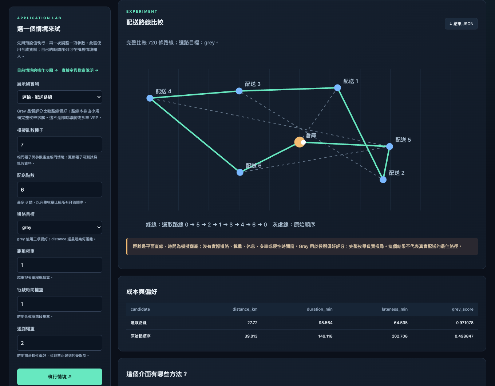
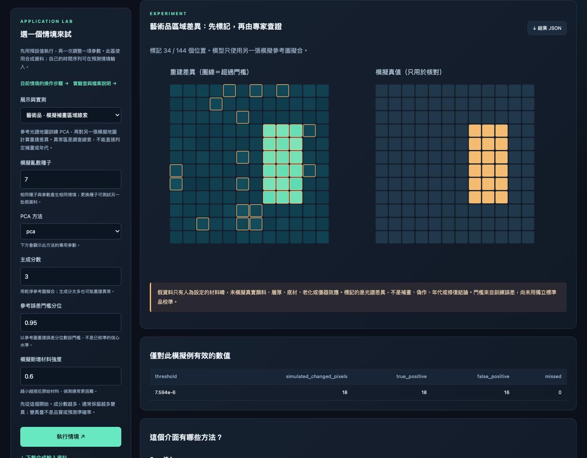
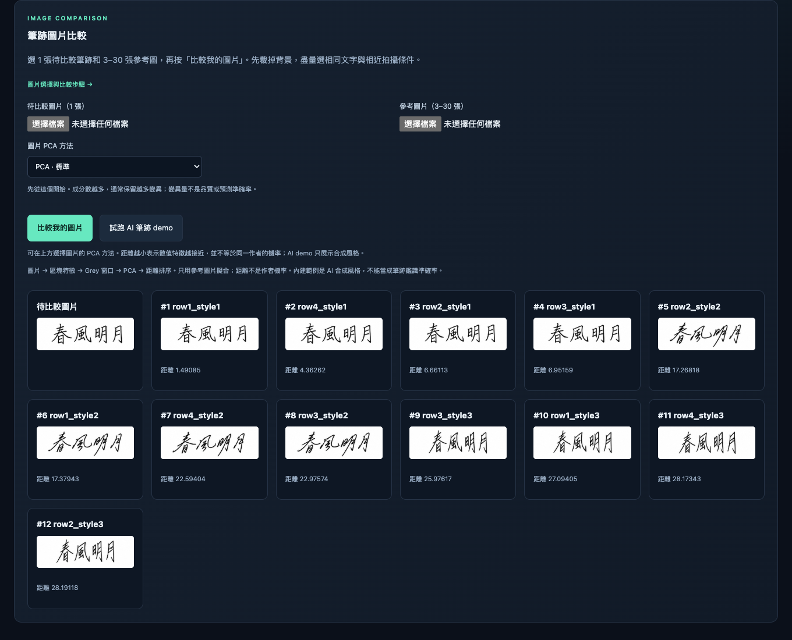

# Documentation

**English** | [繁體中文](README.zh-TW.md) | [日本語](README.ja.md)

[Usage guide](guide.md) · [GreyTheory](../README.md)

Use this page for the workbench walkthrough. The complete Python examples, API settings, and references are in the usage guide.

> [!NOTE]
> All commands assume the repository root. No real Bruker data or personal records appear in these screenshots.

All demo inputs and results are collected in [data/demo/](../data/demo/README.md). Use the [data browser](../data/demo/index.html) to find each file and its workbench action.

The local file list includes only files that pass a read check. Rejected files and their reasons appear in a separate expandable list. Local entries show ✓ when multi-position/sample analysis is available, or ✗ when fewer than three observations are present. A single spectrum can still be plotted. Reload after adding or replacing files.

<a id="workbench"></a>

## Open the interface

### 1. Preview in a browser

[examples/workbench/index.html](../examples/workbench/index.html)

Double-click the project HTML. No installation or server is needed for the bundled previews. The preview banner stays visible; changed settings prompt for Python analysis.

### 2. Live Python analysis

```bash
python3 run.py workbench
```

`workbench` opens the GreyTheory graphical analysis interface for loading data, choosing methods and parameters, running analysis, and inspecting charts and feature rankings.

The first launch creates `.venv` and installs the analysis and desktop dependencies; later launches reuse it. Analysis runs locally without a server.

- **Spectra / DOE**: load data, choose Grey, GRA, or PCA methods, adjust parameters, and run.
- **Handwriting images**: load a query and reference images to compare feature distances.
- **Built-in demos**: try the synthetic data before loading your own.

## PVD / CVD: load, choose, run

Select PVD or CVD, load the data, choose a response such as thickness_nm, and run. Inspect the projection and GRA ranking, then keep the top features and rerun in live mode. Each process has 15 synthetic runs.


[CSV: PVD](../data/demo/doe/pvd_15.csv) · [CSV: CVD](../data/demo/doe/cvd_15.csv) · [Data manifest](../data/demo/doe/manifest.json)

<a id="gallery"></a>

## Application gallery

### Delivery routes

Choose 3–8 stops and adjust distance/time/lateness preferences. The solver enumerates visit orders; Grey ranks preferences. The screenshot uses the default synthetic scenario.



### Artwork differences

Compare a separately generated reference map with an observed map. The right map is synthetic ground truth for checking this example. Flagged differences are not proof of restoration, age, or authenticity.



### Handwriting images

Use the AI demo, or load one query and 3–30 reference images in live mode. Ranking is based on extracted-feature distance, not the probability of a shared writer.



## Move results between HTML and Python

In direct HTML preview, export a request after changing a setting. Run it below, then import the generated .result.json using the HTML result control.

```bash
python3 run.py workbench --request greytheory-request.json
```

## Method and API guide

| API | |
| --- | --- |
| [GM11 / Convolution](guide.md#time-series-forecasting) | **Forecast:** GM11 and two-level Convolution; GM0N / GM1N for ordered multivariate data. |
| [GRA / GreyPCA](guide.md#pca-and-feature-selection) | All six PCA backends, parameters, and component selection |
| [Quality](guide.md#quality-scoring) | BenefitNormalizer · grade_quality · rank_quality |
| [Images / trajectories](guide.md#start-with-image-files) | Loading images, feature extraction, and comparison |
| [Bruker](guide.md#bruker-file-readers) | SPX / BCF support and detector calibration |
| [Usage guide](guide.md) | Forecasting, GRA, quality scores, batch jobs, and references |
