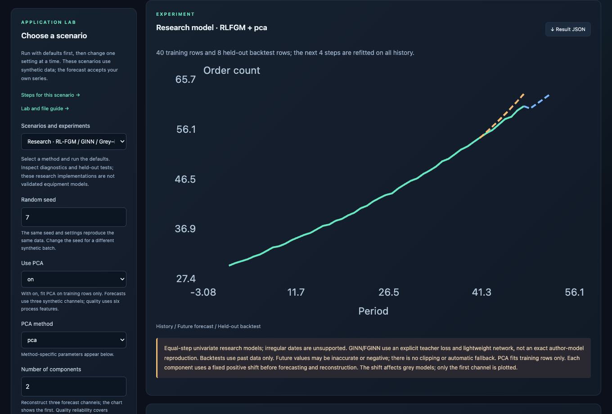
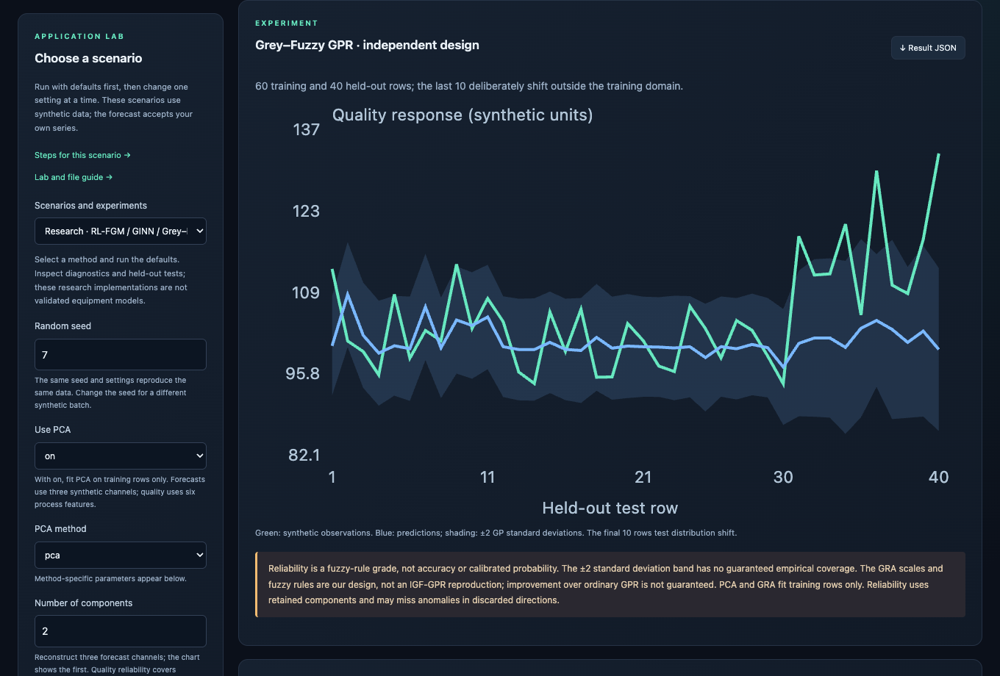
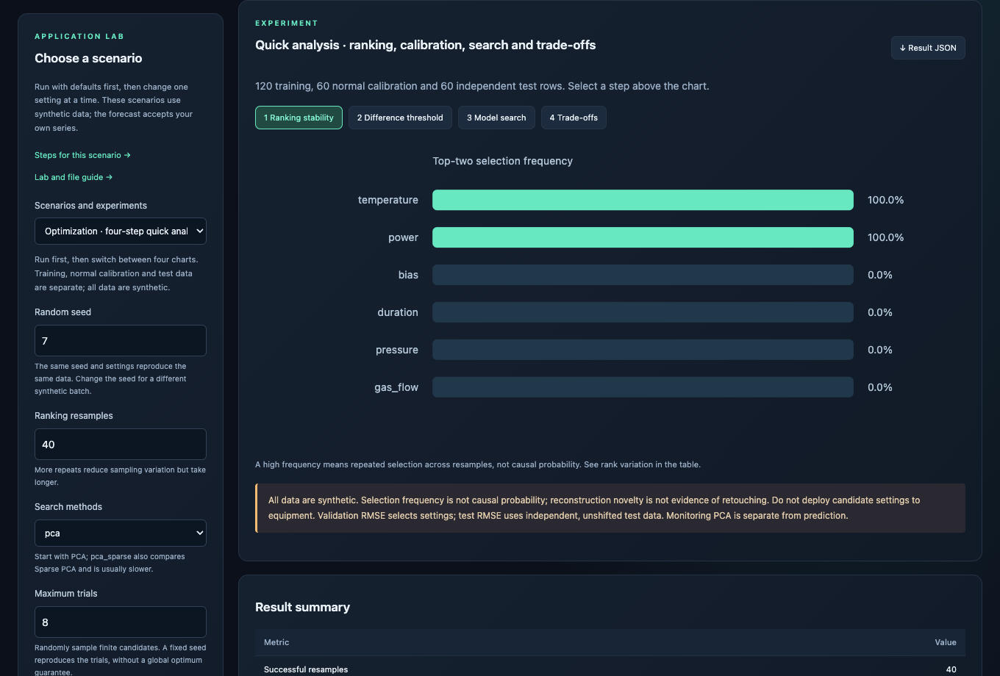
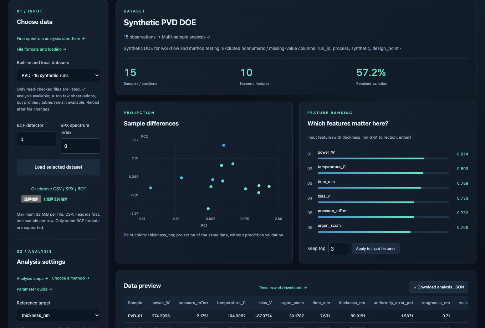
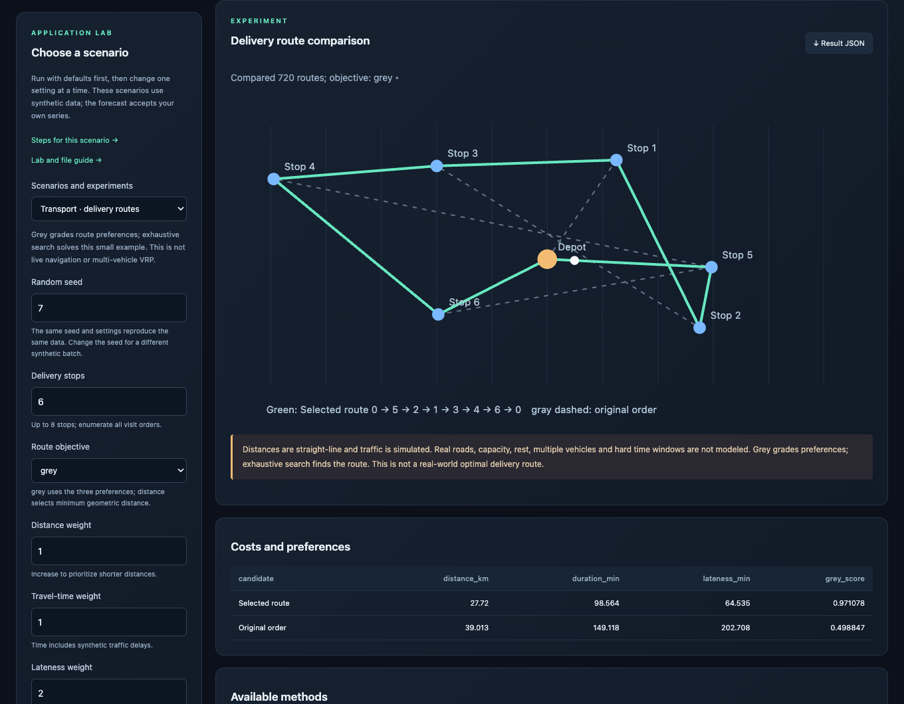
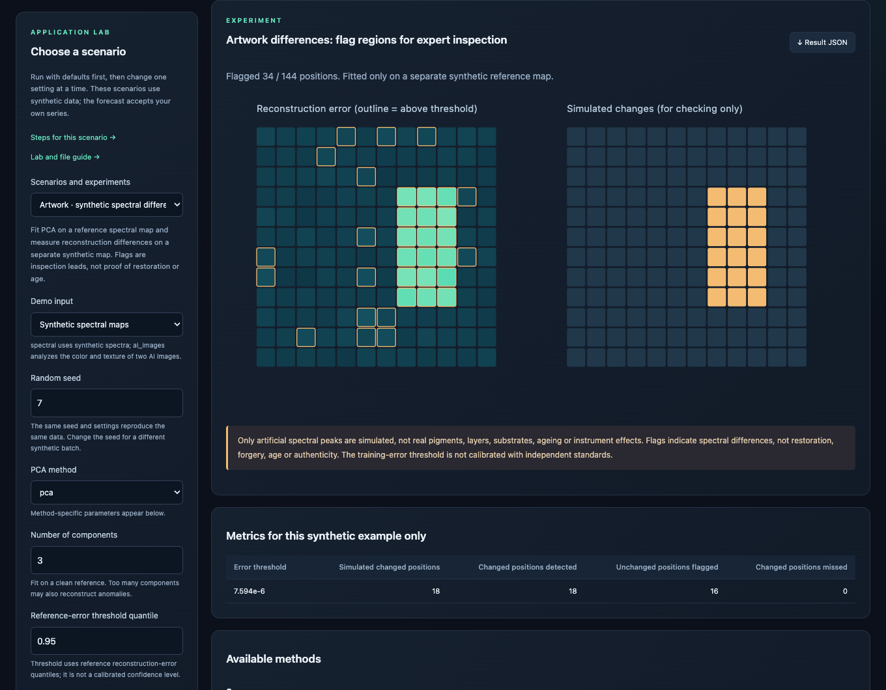
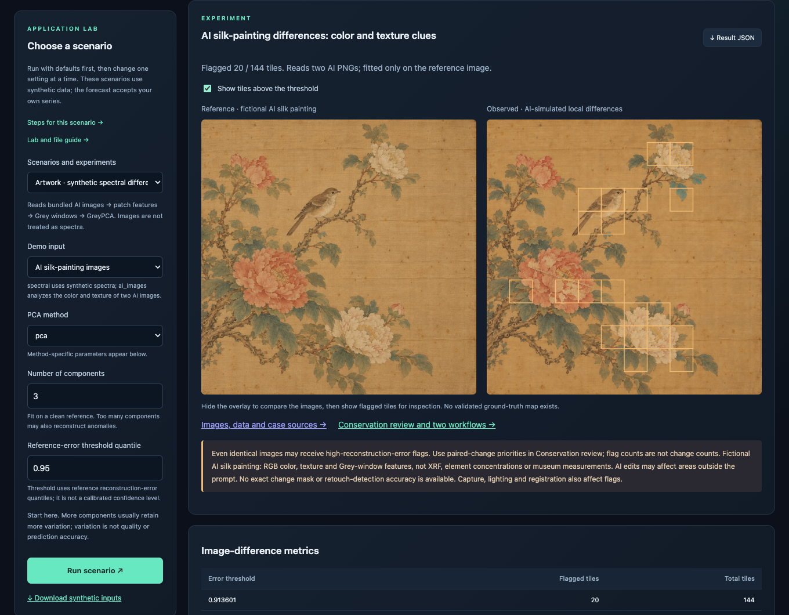
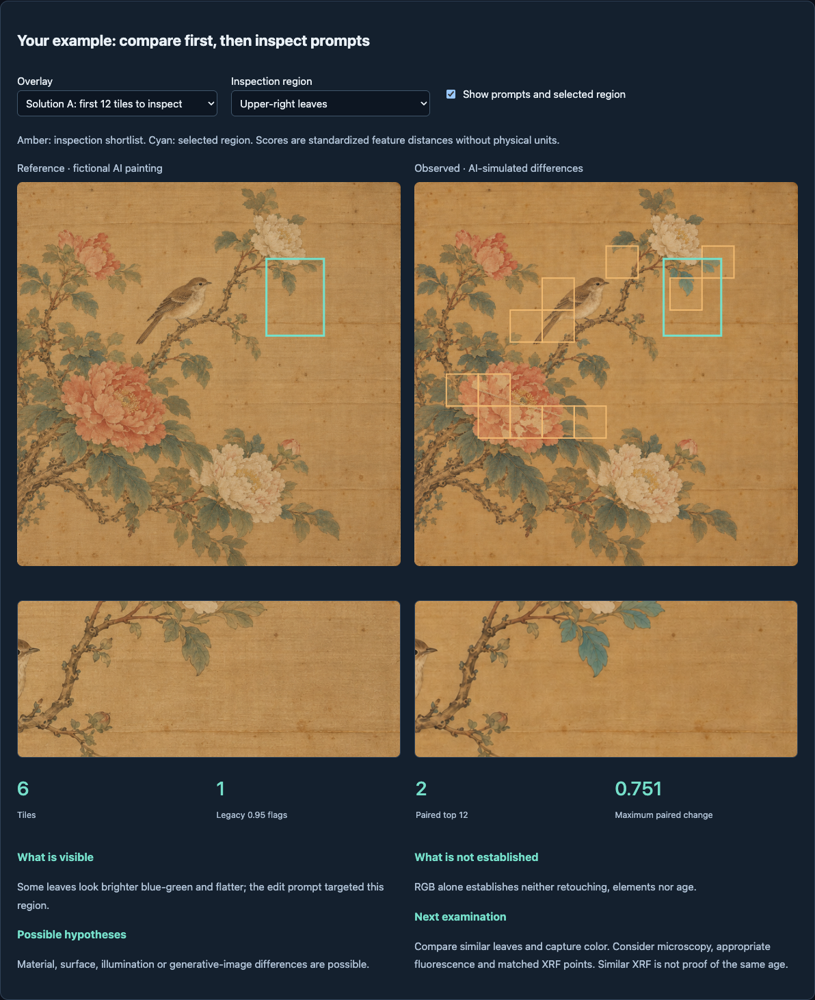
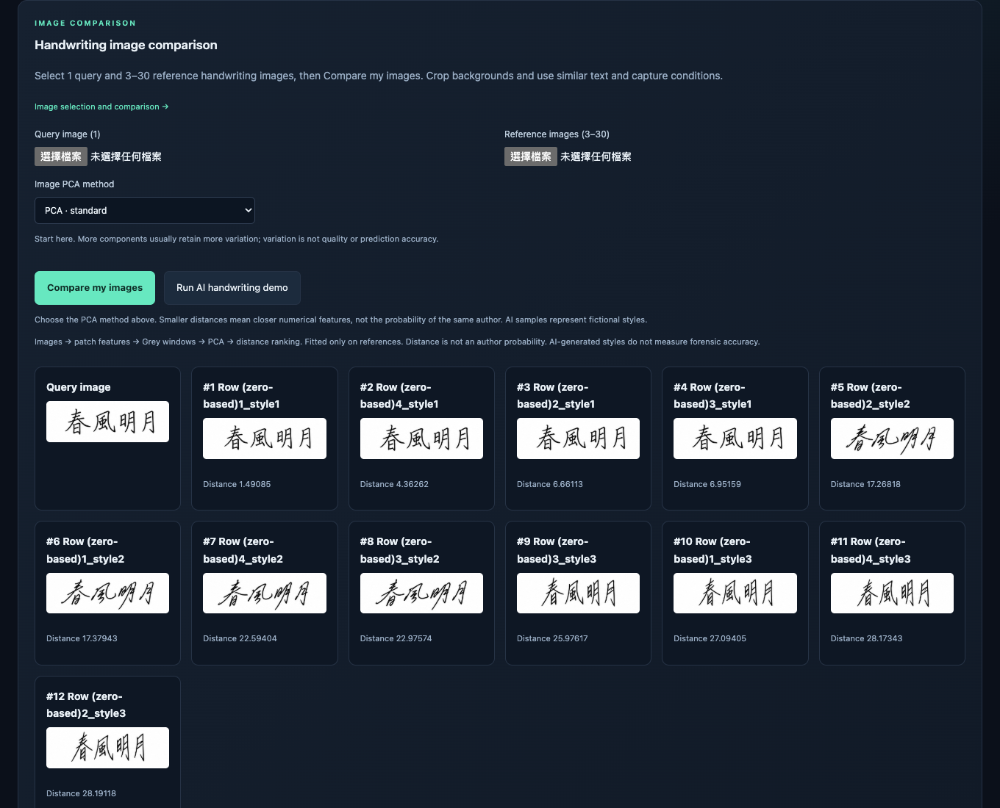

# Documentation

**English** | [繁體中文](README.zh-TW.md) | [日本語](README.ja.md)

[Usage guide](guide.md) · [GreyTheory](../README.md)

Use this page for the workbench walkthrough. The complete Python examples, API settings, and references are in the usage guide.

[Stability, threshold calibration, GreyPCA search and Pareto alternatives](guide.md#stability-calibration-and-optimization) are available as Python functions. Run all four examples with `python3 run.py optimize`; the JSON report is saved to `artifacts/optimization/report.json`. They are also available in the GUI under Application lab → Optimization · four-step quick analysis.

> [!NOTE]
> All commands assume the repository root. No real Bruker data or personal records appear in these screenshots.

All demo inputs and results are collected in [data/demo/](../data/demo/README.md). Use the [data browser](../data/demo/index.html) to find each file and its workbench action.

The local file list includes only files that pass a read check. Rejected files and their reasons appear in a separate expandable list. Local entries show ✓ when multi-position/sample analysis is available, or ✗ when fewer than three observations are present. A single spectrum can still be plotted. Reload after adding or replacing files.

## Research-model demos

Run `python3 run.py workbench`, open **Application lab → Research**, select a method and run. No file is required; the examples are synthetic.

- **rlfgm:** start with automatic order selection. Compare history, eight held-out observations and four future steps. Auto order uses a training-only validation tail.
- **ginn / fginn:** start with window 3 and grey weight 0.1. Inspect convergence before interpreting the curve. FGINN with order=beta=1 recovers the ordinary grey teacher; weight 0 trains a plain network.
- **grey_fuzzy_gpr:** compare ordinary GP and the grey variant on the same held-out rows. Green is observed, blue is predicted; the band is ±2 GP standard deviations, not guaranteed coverage. The final ten rows deliberately shift domains. Fuzzy reliability is not correctness probability.

Default results for all methods are bundled in the direct HTML preview. Parameter changes require the Python window or request/result exchange. **Result JSON** keeps diagnostics and warnings. [Mathematical definitions and implementation differences](guide.md#experimental-research-models) distinguish the RL core from independently adapted neural and GPR variants. For a full baseline comparison use `python3 run.py research`; its report includes cases where the new methods lose.




In Workbench, choose Research models → Use PCA: on. Forecast components need a declared training-only positive shift; this affects grey models. Quality reliability applies only to retained components.

## Four-step optimization demo

Open `python3 run.py workbench`, select **Application lab → Optimization · four-step quick analysis**, then **Run scenario**. No file is required.

1. **Ranking stability:** check top-two selection frequencies. More resamples take longer.
2. **Difference threshold:** orange points exceed a threshold fitted on 60 separate normal rows; purple outlines mark injected shifts. Set shift to zero and rerun to inspect normal false alarms.
3. **Model search:** compare validation RMSE across candidate settings. Independent, unshifted test RMSE is reported separately.
4. **Trade-offs:** orange Pareto options balance quality loss and cost. Lower the cost limit and rerun; grey points are infeasible.

The buttons switch charts without recomputing. Changing left-hand parameters needs Python analysis. Use **Result JSON** to save settings, trials and the full quick-function report. Training/calibration/test sizes are 120/60/60; all inputs are synthetic. This scenario does not add a file-upload control. Direct HTML includes the default Python-computed preview; use the existing request/result exchange for changed settings.




<a id="workbench"></a>

## Open the interface

### 1. Preview in a browser

[examples/workbench/index.html](../examples/workbench/index.html)

Double-click the project HTML. No installation or server is needed for the bundled previews. The preview banner stays visible; changed settings prompt for Python analysis.

### 2. Live Python analysis

```bash
python3 run.py workbench
```

`workbench` opens the GreyTheory graphical analysis interface for loading data, choosing methods and parameters, running analysis, and inspecting charts and feature rankings.

The first launch creates `.venv` and installs the analysis and desktop dependencies; later launches reuse it. Analysis runs locally without a server.

- **Spectra / DOE**: load data, choose Grey, GRA, or PCA methods, adjust parameters, and run.
- **Handwriting images**: load a query and reference images to compare feature distances.
- **Built-in demos**: try the synthetic data before loading your own.

## PVD / CVD: load, choose, run

Select PVD or CVD, load the data, choose a response such as thickness_nm, and run. Inspect the projection and GRA ranking, then keep the top features and rerun in live mode. Each process has 15 synthetic runs.

Use the language selector in the header for English, 繁體中文 or 日本語. Switching language keeps your current inputs and results.



[CSV: PVD](../data/demo/doe/pvd_15.csv) · [CSV: CVD](../data/demo/doe/cvd_15.csv) · [Data manifest](../data/demo/doe/manifest.json)

<a id="gallery"></a>

## Application gallery

### Delivery routes

Choose 3–8 stops and adjust distance/time/lateness preferences. The solver enumerates visit orders; Grey ranks preferences. The screenshot uses the default synthetic scenario.



### Artwork differences

Compare a separately generated reference map with an observed map. The right map is synthetic ground truth for checking this example. Flagged differences are not proof of restoration, age, or authenticity.

For a live artwork demonstration, open Application lab → Artwork differences. Run with seed 7, PCA, 3 components, quantile 0.95 and strength 0.6. Compare the error map with the 18 simulated changed positions. Raise quantile to 0.99 and rerun; then restore 0.95 and lower strength to 0.2. Keep the seed fixed and download each result JSON. The in-app manual includes these steps.

This example uses synthetic spectral maps, not artwork photographs. Real paired-map upload is not available in this lab. A flagged region is a lead for examination, not evidence of retouching or authenticity.



### AI silk-painting images

In Application lab → Artwork, choose **AI silk-painting images** and run the defaults. This reads the two bundled PNGs through patch features → Grey windows → GreyPCA. Hide/show the overlay, then raise quantile to 0.99 and rerun.

The example is an original fictional painting inspired by public conservation reports. It does not reproduce a museum object; RGB differences do not identify materials. AI editing has no exact validated change mask.



[Images, computed CSV / JSON and case sources](../data/demo/artwork/index.html) · [AI prompts / provenance](../data/demo/artwork/provenance.json)

Recompute the bundled pair with `python3 run.py artwork`. For your own aligned pair: `python3 run.py artwork --reference reference.png --observed observed.png`. Results go to `artifacts/artwork/`. Match dimensions, field of view and lighting; registration is not automatic.

In Python, call `from examples.demos import compare_artwork_images`, then `compare_artwork_images("reference.png", "observed.png")`. The GUI accepts the exported `observed_features.csv` on Spectra / DOE, with one tile per row. The analysis JSON is a numeric result, not a GUI result-import envelope.

### Conservation review: two practical workflows

The paired-image view ranks corresponding feature changes for human inspection. The spectral view compares six methods with separate normal calibration and held-out simulation. An identical-PNG control shows why legacy reconstruction flags are not change counts. The region cards demonstrate observations, alternative explanations and next examinations; they are not an expert endorsement.

[Open the interactive review and experiment results](../data/demo/artwork/review/index.html)



### Handwriting images

Use the AI demo, or load one query and 3–30 reference images in live mode. Ranking is based on extracted-feature distance, not the probability of a shared writer.



## Move results between HTML and Python

In direct HTML preview, export a request after changing a setting. Run it below, then import the generated .result.json using the HTML result control.

```bash
python3 run.py workbench --request greytheory-request.json
```

## Method and API guide

| API | |
| --- | --- |
| [GM11 / Convolution](guide.md#time-series-forecasting) | **Forecast:** GM11 and two-level Convolution; GM0N / GM1N for ordered multivariate data. |
| [GRA / GreyPCA](guide.md#pca-and-feature-selection) | All six PCA backends, parameters, and component selection |
| [Quality](guide.md#quality-scoring) | BenefitNormalizer · grade_quality · rank_quality |
| [Images / trajectories](guide.md#start-with-image-files) | Loading images, feature extraction, and comparison |
| [Bruker](guide.md#bruker-file-readers) | SPX / BCF support and detector calibration |
| [Usage guide](guide.md) | Forecasting, GRA, quality scores, batch jobs, and references |
