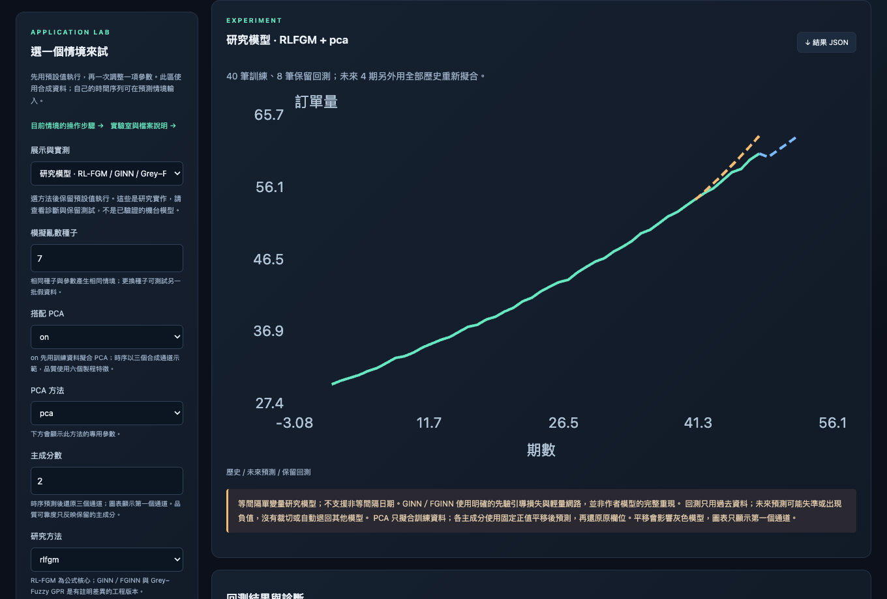
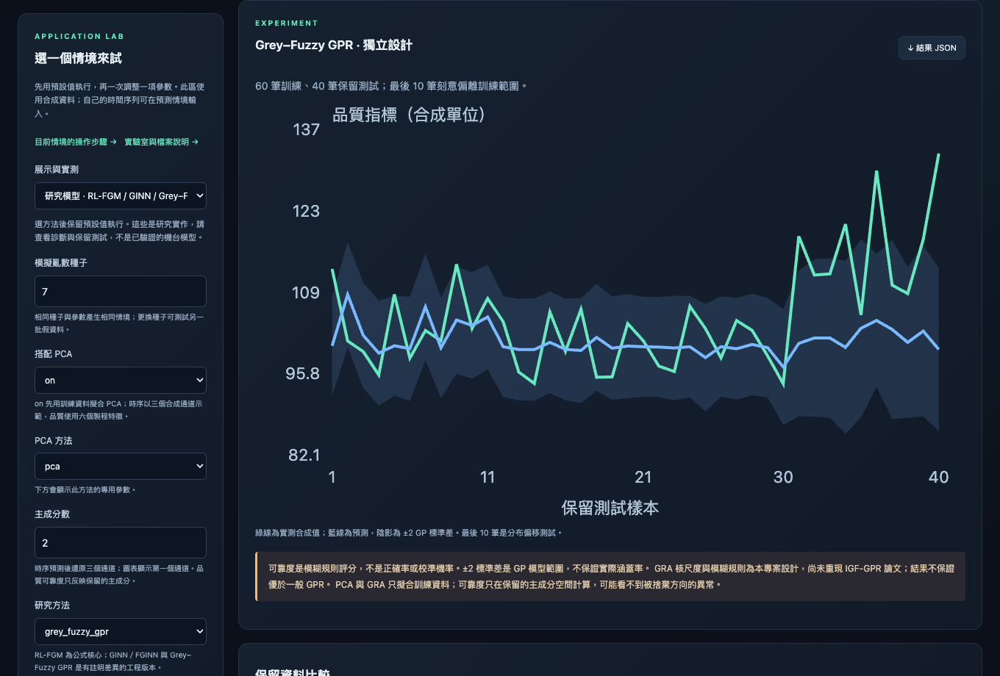
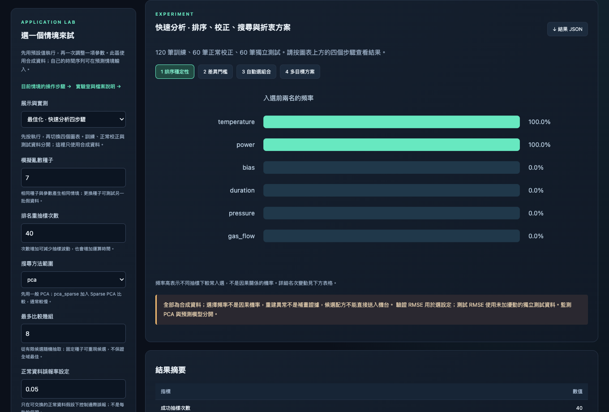
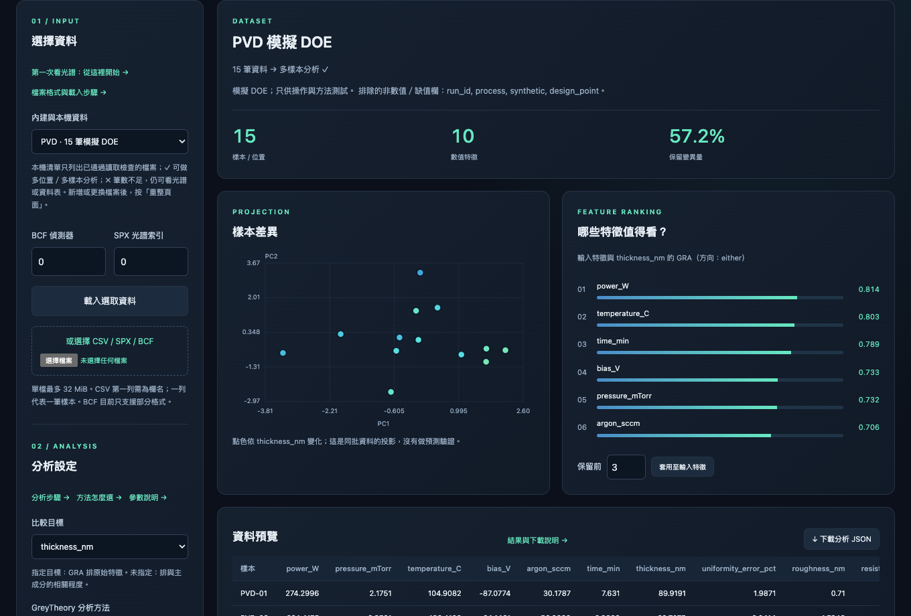
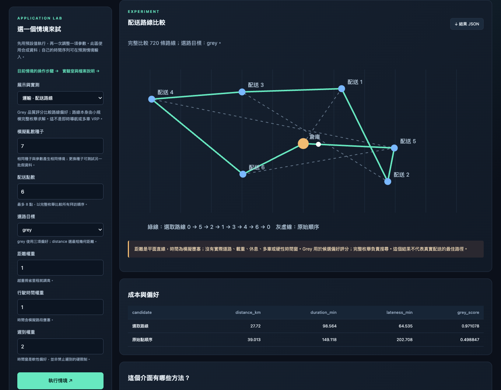
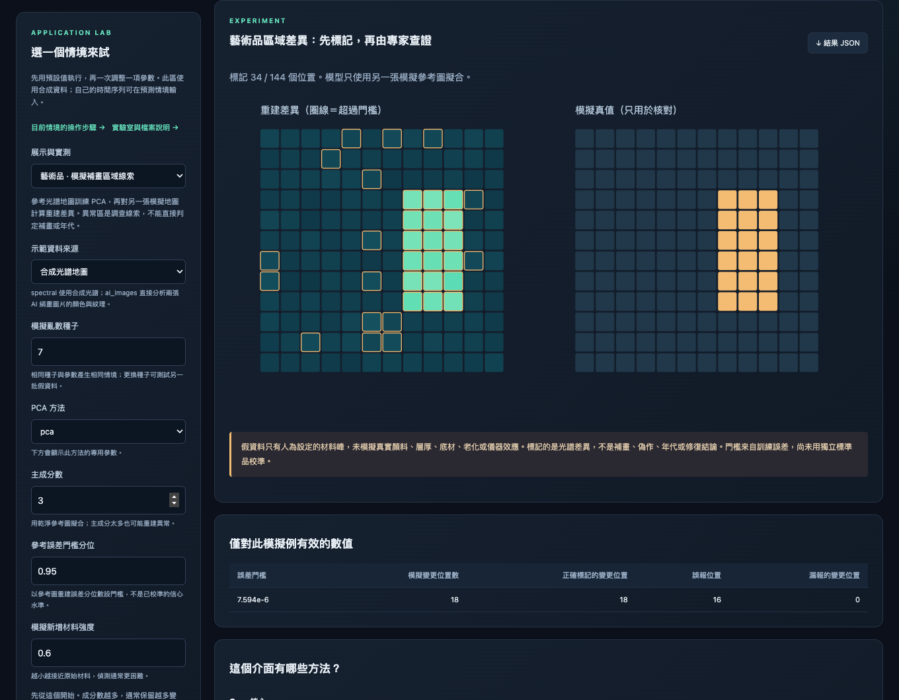
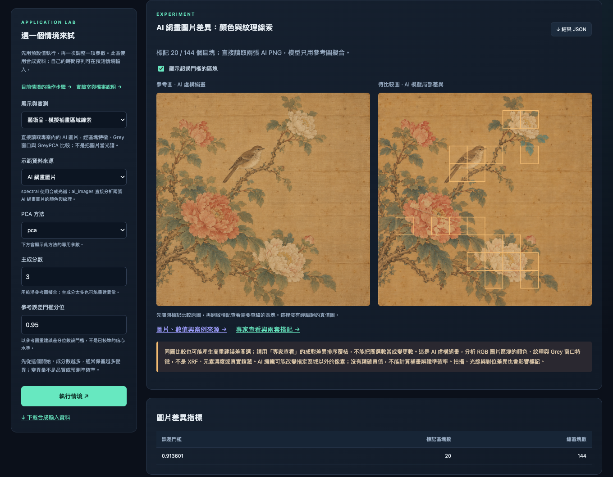
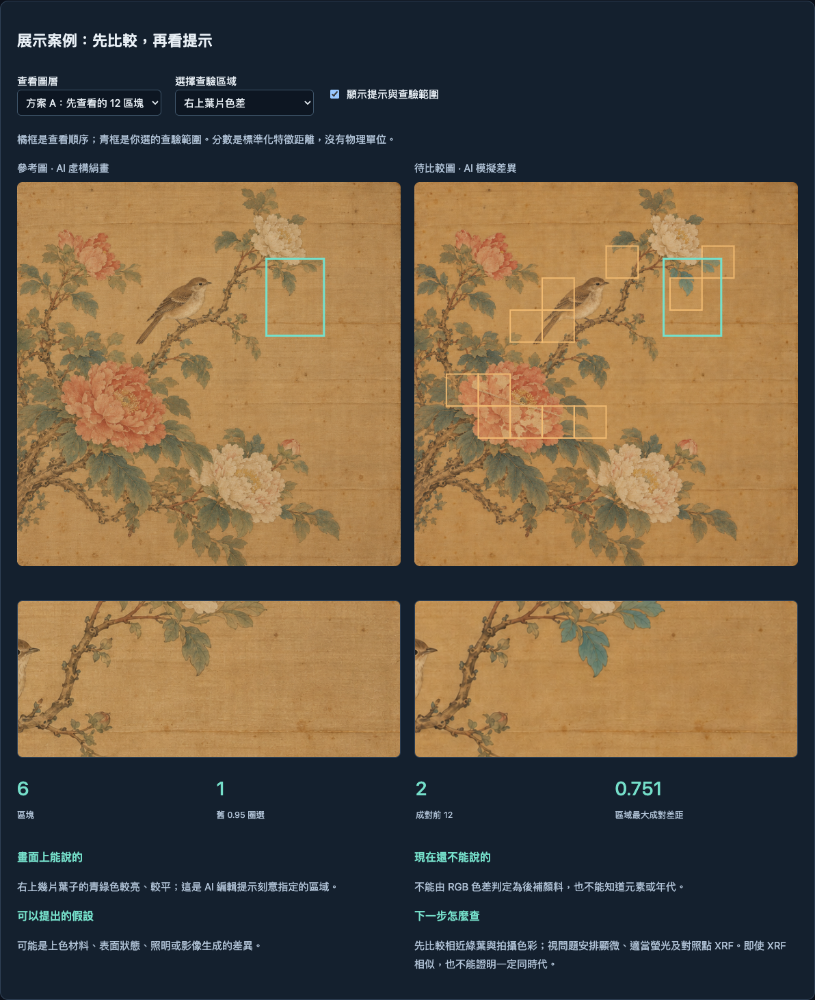
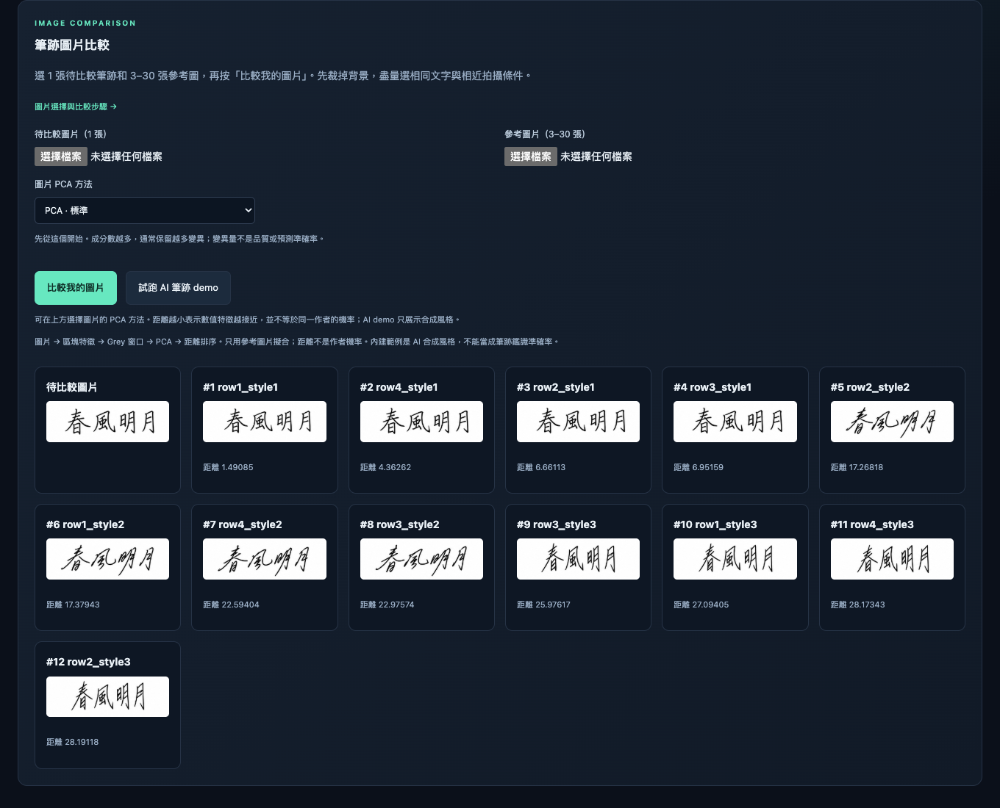
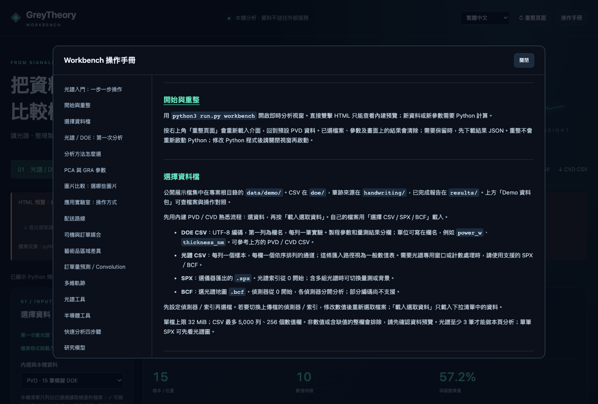

# Documentation

[English](README.md) | **繁體中文** | [日本語](README.ja.md)

[完整使用說明](guide.zh-TW.md) · [GreyTheory](../README.zh-TW.md)

這頁用截圖帶你操作介面；完整 Python 用法、參數和文獻放在使用說明裡。

[排序穩定性、門檻校正、GreyPCA 搜尋與 Pareto 折衷方案](guide.zh-TW.md#排序穩定性門檻校正與最佳化)可直接用 Python 呼叫。執行 `python3 run.py optimize` 跑四步驟範例，報告存到 `artifacts/optimization/report.json`。GUI 也能操作：進入「應用實驗室 → 最佳化 · 快速分析四步驟」。

> [!NOTE]
> 以下指令都在專案根目錄執行。這些截圖只使用合成資料，沒有私人 Bruker 資料或個人紀錄。

展示資料已集中在 [data/demo/](../data/demo/README.md)。先開 [資料包入口](../data/demo/index.html)，可查到要選的檔案與操作頁；PVD／CVD CSV、筆跡來源圖、情境輸入和結果報告都在同一處。

本機下拉清單只列出已通過讀取檢查的檔案；不能讀取的檔案另列在「未支援或無法讀取的檔案」，可展開查看原因。清單會標示「單筆光譜 → 多位置分析 ✗」或「9 個位置 → 多位置分析 ✓」。✓ 表示可分析；✗ 表示不足 3 個位置，但仍可看光譜。新增或更換檔案後按「重整頁面」。

## 研究模型展示

執行 `python3 run.py workbench`，進入 **應用實驗室 → 研究模型**，選方法後執行。不用選檔案，這裡使用合成資料。

- **rlfgm**：先用自動階數，看歷史、8 筆保留回測與未來 4 期。自動階數只使用訓練資料內的時間保留段。
- **ginn／fginn**：先用窗口 3、先驗權重 0.1，查看收斂狀態再讀曲線。FGINN 的 order=beta=1 回到一般灰色先驗；權重 0 則訓練一般網路。
- **grey_fuzzy_gpr**：在相同保留資料比較一般 GP 與灰色版本。綠線是合成實測、藍線是預測；陰影是 ±2 GP 標準差，不保證實際涵蓋率。最後 10 筆刻意偏移。模糊可靠度不是正確機率。

直接開 HTML 已包含所有方法的預設結果；修改參數需使用 Python 視窗或請求／結果交換。「結果 JSON」會保留診斷與警告。[數學定義與實作差異](guide.zh-TW.md#研究模型rl-fgmginn-與-greyfuzzy-gpr)清楚區分 RL 公式核心、神經網路工程版本與獨立設計的 GPR。完整基準比較用 `python3 run.py research`，報告也包含新方法比較差的情況。




GUI 選「研究模型 → 搭配 PCA：on」。時序主成分採訓練資料決定的正值平移，這會影響灰色模型；品質可靠度只反映保留的主成分。

## 最佳化四步驟展示

執行 `python3 run.py workbench`，進入 **應用實驗室 → 最佳化 · 快速分析四步驟**，按 **執行情境**。不用選檔案。

1. **排序穩定性**：看每個特徵入選前兩名的頻率；增加抽樣次數會花較多時間。
2. **差異門檻**：橘點超過另一批 60 筆正常資料校正的門檻；紫邊標示模擬偏移。把偏移強度改為 0 再執行，查看正常資料誤報。
3. **自動選組合**：比較候選的驗證 RMSE；摘要另外顯示未加擾動的獨立測試 RMSE。
4. **多目標方案**：橘點是品質損失／成本的 Pareto 折衷方案。降低成本上限再執行，灰點代表不符限制。

四個按鈕切圖不需重算；左側參數變更後需要 Python。按「結果 JSON」保留參數、試驗紀錄與快速分析完整報告。資料分成 120 筆訓練、60 筆正常校正、60 筆測試，全部是合成資料。此情境沒有新增檔案上傳入口。直接開 HTML 可看預設的 Python 計算結果；改參數可使用既有的匯出請求／匯入結果流程。




<a id="workbench"></a>

## 開啟操作介面

### 1. 直接看離線預覽

[examples/workbench/index.html](../examples/workbench/index.html)

雙擊專案附的 HTML，不必安裝套件或啟動 server，就能查看內建展示。頁面會保留預覽提示；變更設定時會提醒你改用 Python 計算。

### 2. 即時分析自己的資料

```bash
python3 run.py workbench
```

`workbench` 會開啟 GreyTheory 的圖形分析介面，讓你載入資料、選擇方法與參數、執行分析，再查看圖表和特徵排序。

第一次會建立 `.venv` 並安裝分析與視窗套件，之後沿用同一環境。分析在本機執行，不需要架設伺服器。

- **光譜／DOE**：載入資料，選擇 Grey、GRA 或 PCA 等方法，調整參數後執行。
- **筆跡圖片**：載入待比較圖片與參考圖片，查看特徵距離排序。
- **內建展示**：先用合成資料試操作，再換成自己的資料。

## PVD／CVD：載入、選目標、執行

選 PVD 或 CVD，按載入，再選 thickness_nm 等目標並執行。看完投影與 GRA 排序後，可套用前幾名特徵，在即時模式重跑。每種製程各有 15 筆合成實驗。

右上角可切換繁體中文、English、日本語；切換時會保留目前的資料、參數與結果。



[CSV: PVD](../data/demo/doe/pvd_15.csv) · [CSV: CVD](../data/demo/doe/cvd_15.csv) · [Data manifest](../data/demo/doe/manifest.json)

<a id="gallery"></a>

## 展示與操作截圖

### 配送路線

選 3–8 個配送點，調整距離、時間和遲到權重。拜訪順序由完整枚舉搜尋，Grey 評估偏好；截圖使用預設合成情境。



### 藝術品區域差異

用獨立生成的參考光譜圖建立模型，再觀察待測圖的差異。右側是用來核對的模擬真值。被標記的區域不是補畫、年代或真偽的判定。

現場展示順序：

1. 執行 `python3 run.py workbench`，進入「應用實驗室」，選藝術品情境。
2. 先用 seed 7、PCA、3 個成分、門檻分位 0.95、材料強度 0.6 執行。左圖看誤差與圈選位置，右圖核對刻意變更的 18 個位置。
3. 門檻改為 0.99 重跑，觀察標記數、誤報與漏報。
4. 恢復 0.95，強度降為 0.2，以相同 seed 重跑，觀察較細微的差異。每次下載結果 JSON。

可向廠商這樣說：「先用一張參考光譜地圖建立基準，再把不同的位置標出來，幫專家縮小要查驗的範圍。」

這是合成光譜地圖的差異展示，不是上傳作品照片。此情境尚無真實參考／待測地圖成對匯入功能；標記區需要由修復專家查驗，不能直接當作補畫或真偽結論。



### AI 絹畫圖片

在「應用實驗室」→ 藝術品情境，把「示範資料來源」切到 **AI 絹畫圖片**，按預設值執行。程式會讀取兩張 PNG，經區塊特徵 → Grey 窗口 → GreyPCA 計算。關閉／開啟標記比較畫面，再把門檻改成 0.99 重跑。

這幅原創虛構絹畫參考公開修復議題，不是館藏複製品；RGB 差異不能推斷顏料成分。AI 編輯沒有經驗證的精確變更真值。



[圖片、實際 CSV／JSON 與案例來源](../data/demo/artwork/index.html) · [AI prompts / provenance](../data/demo/artwork/provenance.json)

`python3 run.py artwork` 可重新分析內附圖片。自己的對齊圖片可用 `python3 run.py artwork --reference reference.png --observed observed.png`；結果放在 `artifacts/artwork/`。兩張圖需尺寸、拍攝範圍一致，光線相近；不會自動對位。

Python 可直接呼叫 `from examples.demos import compare_artwork_images`，再執行 `compare_artwork_images("reference.png", "observed.png")`。輸出的 `observed_features.csv` 可在「光譜 / DOE」匯入，每列一個區塊；分析 JSON 是數值結果，不是 GUI「匯入 Python 結果」用的交換檔。

### 專家查看：兩套實務搭配

成對圖片用來排查驗順序；光譜用獨立正常資料校準門檻，再搭配實物檢查。實測也加入同圖負對照：舊重建誤差圈選數不能當成變更數。展示可選葉片、花瓣、鳥身與背景，逐區查看觀察、假設和下一步檢查；內容是依公開專業流程撰寫的模擬判讀。

[開啟專家查看與實測報告](../data/demo/artwork/review/index.html)



### 筆跡圖片

即時模式可放入一張待比較圖片與 3–30 張參考圖片，也能先看 AI demo。排序依據是特徵距離，不是同一作者的機率。



## HTML 與 Python 交換結果

直接開 HTML 時，調整設定後可匯出運算請求。執行下面的指令，再用 HTML 的匯入結果按鈕載入產生的 .result.json。

```bash
python3 run.py workbench --request greytheory-request.json
```

## 光譜入門：一步一步操作


<p>先把光譜想成「某個量測位置記錄的一長串訊號」。一條線是一個位置；比較多個位置，就能觀察哪裡的訊號組合不同。M4 可做點、線與面掃描；這裡分析的是讀進來的數值。</p>
<h4>第一輪照這樣做</h4><ol>
<li>「內建與本機資料」選<b>合成 XRF · 144 個位置</b>。若要試本機實測資料，可選 <code>m4_tornado/minBcf.bcf</code>，目前可讀出 9 個位置。</li>
<li>「BCF 偵測器」先用 0；「SPX 光譜索引」先用 0。按<b>載入選取資料</b>。</li>
<li>先確認右側名稱已換成光譜資料，樣本數為 144 或 9。如果出現載入失敗，舊畫面不代表新檔已讀取。</li>
<li>看「光譜輪廓」：橫軸是能量，縱軸是記錄到的訊號量。先觀察不同線的峰位置、形狀和高度。</li>
<li>「比較目標」改成<b>不指定目標 · 看資料差異</b>；分析方法選 <b>GreyPCA + 特徵排序</b>，PCA 方法選標準 <code>pca</code>。</li>
<li>保留主成分用 2；GRA 保留主成分先填 0；保留光譜總計數正規化與預設輸入特徵。</li>
<li>按<b>執行分析</b>。左圖看位置間的差異，右側找值得回頭檢查的能量區間。</li>
<li>先記下靠得近／離得遠的樣本，再看排序前幾個區間。不急著刪特徵；需要保存時先下載分析 JSON。</li></ol>
<h4>畫面上每一項的意思</h4>
<table><thead><tr><th>操作／圖表</th><th>意思與第一輪設定</th></tr></thead><tbody>
<tr><td>內建與本機資料</td><td>選資料來源；選完還要按載入。PVD／CVD 是製程數值表，不是光譜。</td></tr>
<tr><td>BCF 偵測器</td><td>選同一次量測使用的哪個感測器。0 是第一個，不是關閉；不能把不同偵測器當成可直接相加。</td></tr>
<tr><td>SPX 光譜索引</td><td>選 SPX 中的第幾組光譜，從 0 開始。可能含樣品或背景；載入 BCF 時不用這項。</td></tr>
<tr><td>載入選取資料</td><td>讀下拉清單中的檔案。右側資料名稱與筆數改變才算載入成功。</td></tr>
<tr><td>選擇 CSV／SPX／BCF</td><td>從電腦挑另一個檔案，選完立即讀取；不是讀取上方下拉選單。SPX 常只有一筆，單筆可看光譜圖，無法做位置間 PCA。</td></tr>
<tr><td>比較目標</td><td>問「哪些特徵與這個已知數值較相關」。沒有濃度或品質實測值，先不指定。不要隨便選一個能量欄當品質目標；合成 Cu 混合權重也不是真實 Cu 濃度。</td></tr>
<tr><td>分析方法／PCA 方法</td><td>前者選整個分析流程，後者選其中的降維方式。第一輪都用標準 GreyPCA／pca，先看懂結果再換方法。</td></tr>
<tr><td>保留主成分</td><td>用幾個綜合數值描述原本很多欄的差異。先用 2，對應圖上的 PC1、PC2；它們不是兩種元素。</td></tr>
<tr><td>GRA 保留前幾個主成分</td><td>依已知目標再篩主成分。第一輪填 0 表示不用；填正數時必須有目標。</td></tr>
<tr><td>GRA 參數</td><td>控制與目標的比較方式。先保留 rho 0.5、zscore、either；這些不是儀器能量或偵測器設定。各參數見手冊「PCA 與 GRA 參數」。</td></tr>
<tr><td>光譜按總計數正規化</td><td>先讓每個樣本的總訊號量相同，再比較形狀；不會把數值轉成濃度。若要研究總強度差異，可取消後重新比較。上方光譜輪廓仍顯示載入的原始強度。</td></tr>
<tr><td>輸入特徵／全選／還原建議</td><td>決定哪些欄進入分析。光譜先以最多 64 個相鄰能量區間加總；每一欄是一段能量，不是自動辨識出的元素。第一輪保留預設勾選。</td></tr>
<tr><td>執行分析</td><td>按目前資料與設定重新計算；改參數後要再按一次。</td></tr>
<tr><td>光譜輪廓</td><td>橫軸能量是訊號的分類位置；縱軸 Counts 是記錄量，背景估計可能為小數。彩線顯示前 9 個位置，白線是全部位置的平均。峰高不直接等於元素百分比。</td></tr>
<tr><td>位置 y,x／總計數</td><td>位置座標與該點的總訊號。顏色只反映總量，不是某個元素的濃度圖。</td></tr>
<tr><td>樣本差異／PC1、PC2</td><td>每個點代表一個樣本或位置；靠近表示在保留的主成分中較相似。離得遠值得回頭檢查原光譜，但不能直接認定材質不同。</td></tr>
<tr><td>保留變異量</td><td>保留了原資料多少差異。高比例不代表元素辨識率或預測準確率。</td></tr>
<tr><td>特徵排序</td><td>未指定目標時看能量區間與主成分的相關程度；指定目標後看 GRA。它是檢查優先順序，不是元素濃度或因果證據。</td></tr>
<tr><td>保留前／套用至輸入特徵</td><td>只勾選排序前幾名，再重新執行。它會改變分析輸入；先保存完整分析，之後再做篩選。</td></tr>
<tr><td>資料預覽／下載分析 JSON</td><td>預覽顯示部分資料列；JSON 保存這次的設定和結果。一般分析 JSON 不是「匯入 Python 結果」專用的 .result.json。</td></tr></tbody></table>
<h4>這次的 BCF 錯誤</h4><p><code>unsupported or truncated SFS/BCF signature</code> 表示讀取器沒有辨識出它支援的內部結構。副檔名是 BCF，不代表每種編碼都已支援；這則錯誤本身也不能判定檔案損毀。先用合成 XRF 練習，或由儀器軟體匯出 SPX 看單筆光譜。BCF 載入失敗後，先確認右側仍是哪一組舊資料。</p>
<p>要把能量峰解釋成元素、再估算濃度，還需譜線判讀、校正及適用的定量方法。本頁先協助找差異與值得檢查的區間。</p>


## Workbench 操作手冊

介面右上角的「操作手冊」可查看以下步驟；各區的說明按鈕會直接開啟對應章節。「重整頁面」會清除目前設定與結果，先下載要保留的結果。



### 開始與重整

用 `python3 run.py workbench` 開啟即時分析視窗。直接雙擊 HTML 只能查看內建預覽；新資料或新參數需要 Python 計算。
按右上角「重整頁面」會重新載入介面，回到預設 PVD 資料。已選檔案、參數及畫面上的結果會清除；需要保留時，先下載結果 JSON。重整不會重新啟動 Python；修改 Python 程式後請關閉視窗再啟動。

### 選擇資料檔

公開展示檔集中在 [data/demo/](../data/demo/README.md)。CSV 在 `doe/`，筆跡來源在 `handwriting/`，已完成報告在 `results/`。

先用內建 PVD／CVD 熟悉流程：選資料，再按「載入選取資料」。自己的檔案用「選擇 CSV / SPX / BCF」載入。
<ul><li><b>DOE CSV</b>：UTF-8 編碼，第一列為欄名，每列一筆實驗。製程參數和量測結果分欄；單位可寫在欄名，例如 <code>power_w</code>、<code>thickness_nm</code>。可參考上方的 PVD／CVD CSV。</li><li><b>光譜 CSV</b>：每列一個樣本，每欄一個依序排列的通道；這條匯入路徑視為一般數值表。需要光譜專用窗口或計數處理時，請使用支援的 SPX／BCF。</li><li><b>SPX</b>：選儀器匯出的 <code>.spx</code>。光譜索引從 0 開始；含多組光譜時可切換量測或背景。</li><li><b>BCF</b>：選光譜地圖 <code>.bcf</code>。偵測器從 0 開始，各偵測器分開分析；部分編碼尚不支援。</li></ul>
先設定偵測器／索引再選檔。若要切換上傳檔的偵測器／索引，修改數值後重新選取檔案；「載入選取資料」只載入下拉清單中的資料。
單檔上限 32 MiB；CSV 最多 5,000 列、256 個數值欄。非數值或含缺值的整欄會排除，請先確認資料預覽。光譜至少 3 筆才能做本頁分析；單筆 SPX 可先看光譜圖。

### 光譜／DOE：第一次分析

<ol><li>選內建 <b>PVD</b>，按「載入選取資料」。</li><li>「比較目標」選 <code>thickness_nm</code>；「分析方法」先用 <b>GreyPCA + 特徵排序</b>。</li><li>PCA 選標準 <code>pca</code>，保留主成分先用 2；「GRA 保留前幾個主成分」先留 0。</li><li>輸入特徵只勾製程參數。分析膜厚時，不要把其他量測結果一併當成製程參數。</li><li>按「執行分析」。左圖看樣本差異，右側看與目標的 GRA 排序。</li><li>要減少欄位，填「保留前」並按「套用至輸入特徵」，再按一次「執行分析」。按「下載分析 JSON」保存結果。</li></ol>
沒有比較目標時，選「不指定目標」。PCA 路徑會依特徵與主成分的相關程度排序；這和有目標的 GRA 排序不同。修改設定後需要重新執行。

### 分析方法怎麼選

<table><thead><tr><th>方法</th><th>何時用、需要填什麼</th></tr></thead><tbody>
<tr><td>GreyPCA + 特徵排序</td><td>先看樣本差異，再比較特徵；一般 DOE 從這個開始。</td></tr>
<tr><td>GRA</td><td>只比較特徵與目標，不做 PCA；必須選比較目標。</td></tr>
<tr><td>GM(0,N)／GM(1,N)</td><td>分析有先後順序的多變量資料；選目標並確認「資料列有合理的先後順序」。不要把無序 DOE 當成時間序列。</td></tr>
<tr><td>灰品質評分</td><td>排樣本的品質分數。勾要評分的指標，逐欄設定望大、望小或目標值，以及上下界和權重。預設上下界來自資料範圍，請改成適用的範圍；目標值需嚴格落在上下界內。權重不可全為 0。</td></tr>
<tr><td>Grey 窗口 → GreyPCA</td><td>適用由光譜讀取器載入的連續通道資料。設定窗口大小和位移；窗口不可超過可用通道數。</td></tr>
<tr><td>PoissonPCA</td><td>只用於非負原始光子計數。不要用背景扣除、濃度、已正規化或估計背景資料。</td></tr></tbody></table>

### PCA 與 GRA 參數

<ul><li><b>PCA</b>：先選標準 <code>pca</code>、保留 2 個成分。Sparse 的 alpha 越大通常越稀疏；Kernel 先試 rbf，gamma 控制尺度；Robust 系列用於比較擾動的影響；Adv 的半徑先用 adaptive，manual 才需填 delta。</li><li><b>主成分 GRA 篩選</b>：0 為關閉。啟用時必須選目標，且保留數不可超過已計算的主成分數。</li><li><b>GRA</b>：rho 先用 0.5；不同單位先用 zscore。direction 的 either 比較正反向關係，positive 只比較正向關係；不是品質望大／望小。</li><li><b>光譜總計數正規化</b>：要比較光譜形狀時可保留勾選；要保留原始強度差異時取消。DOE 不用這個選項。</li></ul>
主成分正負與變異量都不是品質好壞。若要評品質，使用「灰品質評分」設定指標方向。

### 圖片比較：選哪些圖片

<ol><li>先按「試跑 AI 筆跡 demo」看輸出格式。</li><li>「待比較圖片」選 1 張筆跡；「參考圖片」選 3–30 張已分開存好的筆跡圖片。支援 PNG、JPEG、WebP、BMP、TIFF，每張最多 8 MiB。</li><li>先裁掉大面積空白、桌面或邊框。盡量選相同文字、相近範圍與拍攝條件；不要把整張拼貼圖當成多張參考。</li><li>PCA 先用標準 <code>pca</code>，按「比較我的圖片」。</li><li>看參考圖片排序與距離；距離越小，表示本次擷取的數值特徵越接近。</li></ol>
更換圖片或 PCA 參數後，重新按比較。模型只用參考圖擬合；距離不是同一作者的機率。

### 應用實驗室：操作方式

選情境，先保留預設參數，按「執行情境」。看完結果後一次改一項參數，再執行比較；用相同 seed 可重現同一組合成資料。按「結果 JSON」保存。
除「改用自己的時間序列」外，這區使用內建合成資料，沒有配送、藝術品或軌跡檔案的上傳入口。自己的 DOE 請到「光譜 / DOE」，圖片請到「圖片比較」。下方下載的合成輸入 JSON 供程式使用，不是匯入結果檔。

### 配送路線

選配送點數 3–8，選路目標先用 grey。調整距離、時間、遲到權重後執行，至少一項權重要大於 0。圖上看拜訪順序，表格比較距離、時間及遲到。改用 distance 可比較最短距離路線；權重只對 grey 選路生效。這裡用模擬平面座標，不是真實道路導航。

### 司機與訂單媒合

設定司機人數、訂單數和三項權重後執行。表格列出配對與未媒合訂單；查看載重、技能或可用時間是否滿足。每名司機最多配一單；訂單較多或資格不符時可以沒有配對。調高接貨距離權重可觀察配對變化。

### 藝術品區域差異

先用標準 PCA、3 個成分及預設門檻執行。比較誤差圖、標記區與模擬真值；調低新增材料強度，觀察較細微差異。門檻分位越高，通常標記越少。這裡比較兩張合成光譜圖，不是上傳作品照片；標記區是查驗線索。

### 訂單量預測／Convolution

先選 gm11，預測 2–4 期後執行。看最後 4 期回測與未來預測；切到 convolution 時再設定窗口大小、位移。
自己的序列填在「改用自己的時間序列」：依時間先後輸入 12–120 個正數，用逗號或空白分隔，例如 `80, 84, 82, 89, 91, 90, 96, 98, 100, 103, 102, 108`。留白使用模擬訂單；此處不讀 CSV。Convolution 是兩層 GM11 窗口。

### 多維軌跡

選 2、3 或 4 維，先保留 32 個重採樣點與預設窗口，再執行。看 PCA 投影與距離比較；畫面只畫前兩維，分析會使用選定的全部維度。此區產生合成軌跡；真實軌跡需透過 Python API 載入。

### 光譜工具

選工具後只需填畫面顯示的參數，再按執行。NMF／MCR 用於混合成分分解；MNF／MLPCA 比較噪聲處理；baseline 調整基線平滑；peaks 比較擬峰；element_lines 輸入原子序查譜線。這區使用合成光譜及已知模擬噪聲，分解權重不是元素濃度。

### 半導體工具

選 PVD 或 CVD，再選製程工具。PLS 看保留資料預測；monitor 看 Q／T² 與門檻；suggest 比較降低均勻度誤差的候選；lhs 產生試驗點。先保留預設參數執行，再調主成分、門檻或候選數。這區使用每製程 15 筆合成 DOE；自己的 CSV 請到第一頁分析。

### 結果檔與離線交換

即時視窗：分析後按「下載分析 JSON」或「結果 JSON」。這些 JSON 保存結果，不是原始 CSV，也不是可匯入的新資料集。
直接開 HTML：需要新計算時，按「匯出運算請求」，執行 `python3 run.py workbench --request greytheory-request.json`，再用「匯入 Python 結果」選產生的 `greytheory-request.result.json`。請勿選原始請求或一般結果 JSON。
若按執行後沒有結果，先看頁面頂端的錯誤訊息；確認資料筆數、所選欄位和參數範圍。出現預覽提示時，改用即時視窗或檔案交換。

## 方法與 API 說明

| API | |
| --- | --- |
| [GM11 / Convolution](guide.zh-TW.md#時間序列預測) | **預測數值**：GM11 與兩層 Convolution；有序多變量資料可用 GM0N／GM1N。 |
| [GRA / GreyPCA](guide.zh-TW.md#pca-與特徵篩選) | 六種 PCA、參數與主成分篩選 |
| [Quality](guide.zh-TW.md#品質評分) | BenefitNormalizer · grade_quality · rank_quality |
| [Images / trajectories](guide.zh-TW.md#從圖片檔開始分析) | 圖片讀取、特徵擷取與比較 |
| [Bruker](guide.zh-TW.md#bruker-檔案讀取) | SPX／BCF 支援範圍與偵測器刻度 |
| [完整使用說明](guide.zh-TW.md) | 預測、GRA、品質評分、批次執行與文獻 |
