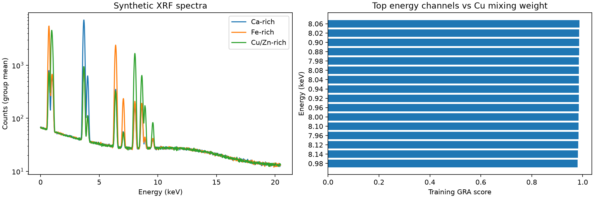
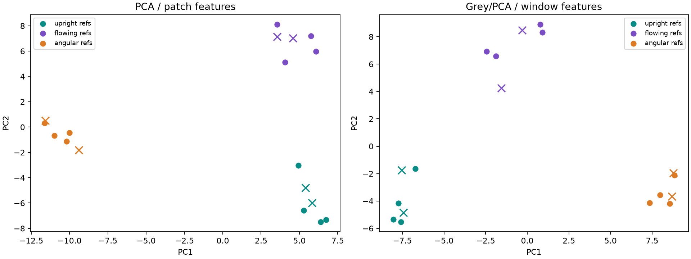

# Usage guide

**English** | [繁體中文](guide.zh-TW.md) | [日本語](guide.ja.md)

All commands below run from the repository root. [Documentation index](README.md) · [Project overview](../README.md).

GreyTheory is a Python toolkit for grey forecasting, grey relational analysis (GRA), and PCA.
Use it to forecast sequences, reduce feature tables, or compare spectra and measurements.

| Task | Start here |
| --- | --- |
| Forecast the next few values | [GM(1,1)](#time-series-forecasting) |
| Forecast with two levels of windows | [Convolution](#convolution-forecasting) |
| Compare features with a target | [GRA](#grey-relational-analysis-gra) |
| Reduce dimensions, then select components | [GreyPCA](#pca-and-feature-selection) |
| Score mixed quality preferences | [Quality scoring](#quality-scoring) |
| Work with paths or images | [Feature extraction](#trajectory-image-and-window-features) |
| Read PNG/JPG files for comparison | [Image-file example](#start-with-image-files) |
| Read Bruker files | [SPX/BCF](#bruker-file-readers) |
| Run synthetic spectra and AI handwriting | [Both demos](#synthetic-xrf-and-ai-handwriting-demos) |

## Get started

Requires Python 3.11 or later. Download or clone the repository, then run from its directory:

```bash
python3 run.py
```

> [!TIP]
> The first run creates `.venv`, installs dependencies, and runs the example.
> Use the same command next time; no environment activation is needed.

To use GreyTheory in your own program, install it from the project directory
with that program's Python environment:

```bash
python -m pip install .
```

## Browser workbench: spectra, DOE, and images

Open [examples/workbench/index.html](../examples/workbench/index.html) directly for bundled previews computed by Python. Changed settings are not silently presented as live calculations.

`workbench` opens the GreyTheory graphical analysis interface. Load spectra, DOE data, or handwriting images, choose methods and parameters, and inspect charts and feature rankings. Run from the project root:

```bash
python3 run.py workbench
```

The first run prepares the environment and optional desktop dependencies. On Windows, use `python run.py workbench`. With dependencies already installed:

```bash
python -m examples.workbench.desktop
```

The interface lives in `examples/workbench/`, outside the installed library. A pywebview bridge calls Python directly from the project HTML in a native window, without an HTTP server or listening port. Direct browser opening is preview mode; new calculations require the desktop window or request/result file exchange. Charts use native SVG and JavaScript, with no CDN or chart dependency.

1. Load **PVD** or **CVD** to try the supplied DOE data.
2. Choose a response, such as `thickness_nm`, as the reference target. Only process inputs are checked by default; other responses are excluded from that initial selection.
3. Run the analysis, inspect the projection and feature ranking, keep the top-ranked inputs with one button, change PCA methods, and download the analysis JSON.
4. For Bruker data, put files in `data/test/` and refresh, or select a CSV, SPX, or BCF file. For the local M4 `minBcf.bcf`, analyze detectors `0` and `1` separately. Use the SPX index to select a measurement or background spectrum; fractional background intensities are estimates, not raw photon counts. Unsupported BCF encodings show an error.
5. Switch to **圖片比較** (image comparison) to run the AI handwriting demo or compare one query with 3–30 reference images. Distances describe feature similarity, not writer identity.

> [!NOTE]
> With a target, ranking uses GRA on the original input features; changing PCA changes the projection but not that GRA ranking. Without a target, ranking uses the maximum absolute correlation with the retained components. This is neither GRA nor causal importance. PC signs do not define quality direction, and this interface does not score quality using PC values.

Spectra use nonnegative-energy channels, summed into at most 64 bins. By default, each spectrum is divided by its total over those retained bins before PCA; the plot still shows raw counts. Single SPX files can be plotted, but this interface requires at least three observations for PCA. Detectors are kept separate because their energy calibrations can differ. DOE inputs are standardized by column. Variance ratios are not available or directly comparable for every PCA backend.

The [synthetic DOE data](../data/demo/doe) contain **30 runs: 15 PVD and 15 CVD**, each with 12 stratified random settings and 3 noisy center replicates. This is not a full factorial or orthogonal design.

| Process | Inputs | Simulated responses |
| --- | --- | --- |
| PVD | Power, pressure, temperature, bias, argon flow, time | Thickness, uniformity error, roughness, resistivity |
| CVD | Temperature, pressure, precursor flow, carrier flow, plasma power, time | Thickness, uniformity error, refractive index, wet etch rate |

These are seeded toy equations with noise, not equipment recipes or production guidance. The [manifest](../data/demo/doe/manifest.json) records equations, ranges, units in column names, and limitations. Analyze each process separately. Rankings use the displayed observations, without held-out validation; they are not predictive accuracy or causal evidence. Thickness and refractive index generally need a target and tolerances; selecting a GRA reference does not imply larger is better.

Regenerate the data:

```bash
python -m examples.workbench.doe
```

The same adapters can be called from Python:

```python
from examples.workbench.analysis import analyze, read_spectrum_file

# Supply your local M4 file; it is not distributed with the package.
data = read_spectrum_file("data/test/m4_tornado/minBcf.bcf", detector=0)
result = analyze(data, {"method": "pca", "components": 2})
print(result["ranking"][:5])  # No target: association with retained components
```

### More application experiments

Open **應用實驗室** (application lab), choose a scenario, edit its parameters, and run it. Desktop mode computes results with Python; direct HTML opening displays clearly marked computed previews. Download JSON to retain the inputs, settings, and results.

| Scenario | Controls | Output |
| --- | --- | --- |
| Delivery routes | 3–8 stops, distance/time/lateness weights | Animated selected route, original-order baseline, costs and grey quality grades |
| Driver matching | Driver/job counts and preference weights | Assignment links and unmatched jobs; payload, skill, and availability are hard eligibility checks |
| Artwork differences | Six PCA backends, components, reference-error quantile, simulated added material | Reconstruction-error map and synthetic ground truth; fitting uses a separate reference map |
| Order forecasting | GM11 or two-level Convolution, alpha, ridge, window, horizon; optional pasted series | Final four observations held out for backtesting, followed by a full-history future forecast |
| Multidimensional trajectories | 2D–4D, resampling, Grey windows, PCA | First two coordinates shown; all dimensions used, with 12 reference and 6 query paths |
| Spectroscopy tools | NMF, MCR-ALS, MNF, MLPCA, AsLS, peak fitting, xraylib lines | Raw/reconstructed curves and diagnostics using inputs suited to each method |
| Semiconductor tools | QualityPLS, Q/T² monitoring, GRA rank_features, GP suggestions, LHS | 11 training and 4 held-out DOE rows for PLS; GP minimizes uniformity error and never controls equipment |
| Image comparison tab | Six PCA methods and parameters, AI or uploaded images | Patches → Grey windows → PCA → distances; no writer attribution claim |

The first tab's analysis selector includes GreyPCA, standalone GRA, GM0N, GM1N, quality grading, Grey windows plus PCA, and raw-count PoissonPCA. GM0N/GM1N depend on accumulated data and row order, so require explicit confirmation of a meaningful sequence. Prefer GRA/PCA for unordered DOE. Quality mode ranks samples, with per-column larger/smaller/target preferences, bounds, and weights; it does not rank input features.

Forms explain the selected method: Kernel PCA exposes kernel/gamma/degree; sparse methods expose sparsity and penalties; AdvPCA exposes adaptive/manual delta, smoothing, and iteration limits. GRA exposes rho, scaling, and direction. Start with rho `0.5`. GreyPCA can additionally retain target-ranked components; zero disables that selection. Component grades are shown separately from input-feature ranking.

> [!NOTE]
> Route search uses exhaustive enumeration; matching uses Hungarian assignment. Grey supplies preference grades, not the optimization solver. Routes use synthetic planar coordinates with no real roads, multi-vehicle constraints, legal working-hour checks, or hard time windows. Artwork anomalies are investigation leads, and image distances do not identify writers. None of these synthetic experiments establish real-world accuracy.

The shareable [synthetic inputs](../data/demo/scenarios/synthetic_inputs.json) include stops, drivers/jobs, orders, and separate reference/observed artwork spectral maps. They contain no real identities, addresses, or artwork. Regenerate with:

```bash
python -m examples.workbench.scenarios
```

Call the same scenario without a browser:

```python
from examples.workbench.scenarios import run_scenario

result = run_scenario("routes", {"stops": 6, "objective": "grey"})
print(result["tables"][0]["rows"])
```

For file exchange without desktop dependencies, export a calculation request in the HTML and run:

```bash
python3 run.py workbench --request greytheory-request.json
```

Import `greytheory-request.result.json` back into the HTML. This uses Python analysis dependencies without any server. Close the desktop window to exit live mode. Raw Bruker files remain ignored by Git.

## Time-series forecasting

Pass observations to `fit`, then call `predict(2)` for the next two values:

```python
from greytheory import GM11

series = [223.3, 227.3, 230.5, 238.1, 242.9, 251.1]
model = GM11(background_mode="corrected").fit(series)
print(model.predict(2))
print(model.metrics)
```

Legacy calls `model.forecast(2)` and `model.forecast_convolution(1, 4)` are also supported. Use `predict(2)` when you only need the next two numeric values; `forecast(2)` refits stored data and updates the configured horizon.

```python
model = GM11().set_data(series)
results = model.forecast(2)
print(model.predict(2))
windows = model.forecast_convolution(1, 4)
print(model.predict(2))
```

Use at least three observations. See Convolution below for two-level window forecasting.

Read coefficients from `model.coefficients` and solver diagnostics from `model.diagnostics`.
`set_data` stores observations for a later batch run. `reset()` clears results;
`reset(clear_data=True)` also clears the data.

<details>
<summary>Background weights, regularization, and errors</summary>

`background_mode="corrected"` uses `alpha * current + (1-alpha) * previous`.
The default `"legacy"` mode multiplies both terms by `alpha`. They agree at `alpha=0.5`.

The solver uses least squares. Set `ridge_alpha` for regularization or
`rank_policy="raise"` to reject fits without uniquely identifiable coefficients.
Diagnostics include rank, condition number, and residuals.

`horizon=0` fits history only. Relative error is `None` for a zero observation;
MAE and RMSE remain available. `predict` leaves stored fit results unchanged.

</details>

## Convolution forecasting

Set `window_size` to enable convolution. Each window uses GM(1,1) to predict its next value;
a second GM(1,1) then fits those predictions:

**Sequence → window predictions → second-level GM(1,1) → future values**

```python
from greytheory import GM11

series = [223.3, 227.3, 230.5, 238.1, 242.9, 251.1]
model = GM11(window_size=4, stride=1, background_mode="corrected").fit(series)
print(model.predict(2))
```

| Setting | Meaning |
| --- | --- |
| `window_size=4` | Four observations per window; `None` uses ordinary GM11 |
| `stride=1` | Advance one observation at a time |
| `predict(2)` | Forecast two future values |
| `correction_mode="legacy"` | Keep the default window-error correction; `"none"` disables it |

For the full two-level method, provide enough data for at least three windows.
The six observations above, with width four and stride one, produce three windows.
`coefficients` and `metrics` describe the final fitted level. The last window can include extra tail observations, matching the original method.

Run the comparison to see both ordinary and convolution forecasts:

```bash
.venv/bin/python examples/convolution_forecast.py
```

Example output:

```text
Ordinary GM11, next two values: [256.5532, 263.1223]
Convolution GM11, next two values: [265.9278, 274.0119]
```

`GreyWindowFeatures` instead extracts local descriptors for PCA/GRA; it does not run the second forecast level.

## Multiple-factor models

`GM0N` and `GM1N` model several factors against one target.
Each row is an observation and each column is a factor:

```python
from greytheory import GM0N

factors = [[.75, .5], [1.22, 1], [.2, .7], [1, .66], [1, 1], [1, .5]]
targets = [1, 1, 1, 1, 1, 1]
model = GM0N().fit(factors, targets, feature_names=["factor_a", "factor_b"])
print(model.coefficients)
print(model.influence_degrees)
```

For GM(1,N), use `GM1N().fit(factors, targets)`. Feature names are optional.
`influence_degrees` ranks absolute coefficients, which depend on units and collinearity.
Use GRA below to compare sequences with a reference.

## Grey relational analysis (GRA)

Supply a reference sequence and candidate sequences. Higher scores mean closer matches
under the chosen normalization:

```python
from greytheory.analysis import grey_relation

scores = grey_relation(
    reference=[0.2, 0.5, 0.8],
    candidates=[[0.2, 0.5, 0.8], [0.8, 0.1, 0.2]],
    rho=0.5,
    normalize="none",
)
print(scores)
```

`normalize` accepts `none`, `minmax`, `zscore`, `initial`, or `mean`.
You can also import `GreyGRA` from `greytheory.analysis` and use `.score(...)` or `.rank(...)`.

Scores depend on the candidate batch, so adding or removing candidates can change the ranking.
They measure grey relation, not causal importance or prediction accuracy.

<details>
<summary>GRA formula</summary>

For each absolute difference `Δ`, the coefficient is
`(Δmin + rho*Δmax) / (Δ + rho*Δmax)`. The score is a weighted mean.
`rho` must be in `(0, 1]`; weights must be nonnegative.
Difference extrema come from the same candidate batch. A score of 1 need not mean identical raw values.

</details>

## PCA and feature selection

`GreyFeatureSelector` selects original columns. `GreyPCA` reduces dimensions, then uses
GRA to select components against a target. This example uses synthetic data:

```python
import numpy as np
from sklearn.model_selection import train_test_split
from greytheory.analysis import GreyFeatureSelector, GreyPCA

random_generator = np.random.default_rng(7)
factors = random_generator.normal(size=(48, 6))
targets = factors[:, 0] + 0.05 * random_generator.normal(size=48)
train_factors, test_factors, train_targets, _ = train_test_split(
    factors, targets, random_state=7
)

selector = GreyFeatureSelector(k=2).fit(train_factors, train_targets)
selected_factors = selector.transform(test_factors)

analysis = GreyPCA(
    n_components=4, method="sparse", method_params={"alpha": 0.1},
    top_k=2, standardize=True,
).fit(train_factors, train_targets)
components = analysis.transform(test_factors)
print(analysis.selected_components)
print(analysis.component_scores)
```

`n_components` sets the decomposition size; `top_k` sets how many components GRA keeps.
Omit the target in `fit(train_factors)` to run dimensionality reduction alone.
> [!IMPORTANT]
> **Split training and test data first.** Fit every transform on training data;
> use only `transform` on test data.

### Switch PCA methods

Change `method` and pass its settings in `method_params`:

| `method` | Decomposition | Example `method_params` |
| --- | --- | --- |
| `"pca"` (default) | PCA | `{"whiten": True}` |
| `"sparse"` | SparsePCA | `{"alpha": 0.1}` |
| `"kernel"` | KernelPCA | `{"kernel": "rbf", "gamma": 0.1}` |
| `"robust"` | PCA projection learned from a PCP low-rank matrix | `{"tol": 1e-6}` |
| `"robust_sparse"` | Huber/elastic-net RobustSparsePCA | `{"alpha": 0.1, "kappa": 1.0}` |
| `"adv"` | AdvPCA | `{"delta": 0.01, "max_iter": 1000}` |

For example, switch to AdvPCA:

```python
analysis = GreyPCA(
    3, method="adv", method_params={"delta": 0.01, "max_iter": 1000},
    top_k=2, standardize=True,
).fit(train_factors, train_targets)
components = analysis.transform(test_factors)
print(analysis.reducer.converged)
print(analysis.reducer.inner_converged)
```

Check both outer and final inner convergence before evaluating AdvPCA results.
See [grey_pca_methods.py](../examples/grey_pca_methods.py) for a comparison of the methods.

You can also supply a sklearn-compatible model with its own component count:

```python
from sklearn.decomposition import IncrementalPCA

analysis = GreyPCA(
    estimator=IncrementalPCA(n_components=4, batch_size=12), top_k=2,
).fit(train_factors, train_targets)
```

Custom models need `fit`, `transform`, and sklearn clone support, and must return a dense
2D matrix with one row per observation. Use either `estimator` or `method`/`method_params`.

### Inspect selected components and rankings

`component_scores` contains GRA scores. `selected_components` contains zero-based indices;
output columns retain their original component order. To list scores from highest to lowest:

```python
valid = np.flatnonzero(np.isfinite(analysis.component_scores))
ranking = valid[np.argsort(-analysis.component_scores[valid], kind="stable")]
for index in ranking:
    print(f"PC{index + 1}", float(analysis.component_scores[index]))
```

Original-column scores are in `selector.scores`. Without a target, `component_scores` is `None`.
This selection works with continuous targets. Writer IDs and other categorical labels need
a separate classification or comparison model.

### Choose the component count

For ordinary PCA, you can specify the cumulative variance to retain, such as 85%:

```python
ordinary = GreyPCA(n_components=0.85, method="pca", standardize=True).fit(train_factors)
print(ordinary.n_components_fitted)
print(ordinary.explained_variance_ratio.sum())

report = analysis.reconstruction_report(train_factors, threshold=0.85)
print(report.prefix_coverage)
print(report.first_prefix_at_threshold)
print(report.selected_coverage)
```

Fractional `n_components` is supported only for ordinary PCA. For AdvPCA or SparsePCA,
inspect reconstruction coverage instead. An 80–85% threshold is a starting point;
use held-out data to check prediction performance, since low-variance components can still carry quality signals.

<details>
<summary>Standalone decompositions and spectral PCA</summary>

Import these from `greytheory.analysis` to use them without GRA:

| Call | Purpose |
| --- | --- |
| `PCAAdapter(3, method="pca")` | PCA |
| `PCAAdapter(3, method="sparse", alpha=0.1)` | SparsePCA |
| `PCAAdapter(3, method="kernel", gamma=0.1)` | KernelPCA |
| `RobustPCA().fit(data)` | Exposes `low_rank` and `sparse` matrices |
| `RobustSparsePCA(3).fit(data)` | Huber/elastic-net sparse projection |
| `AdvPCA(3, delta=0.05).fit(data)` | AdvPCA projection |

Import spectral methods from `greytheory.spectroscopy`:

| Call | Required input |
| --- | --- |
| `PoissonPCA(3).fit_transform(counts)` | Nonnegative counts; approximate variance stabilization |
| `fit_mlpca(data, variances, n_components=3)` | Independent errors with positive variance for each entry |
| `fit_mnf(cube, n_components=3)` | Spatial cube; noise estimated from neighboring pixels |

Use `GreyPCA(estimator=PoissonPCA(3), standardize=False)` to combine PoissonPCA with GRA.
Keep counts nonnegative; do not apply standardization that produces negative values.

</details>

<details>
<summary>Component signs, reconstruction, and method differences</summary>

PCA component signs can flip. By default, `component_direction="either"` compares both signs
in one GRA batch and keeps the higher score. Constant components get NaN scores and are excluded;
`top_k=None` keeps all scorable components. `GreyFeatureSelector` compares the original direction
by default; set `direction="either"` to compare both.

With a quality target, add `align_to_target=True` to orient output signs toward the reference.
Signs are fixed during training; tied scores raise an error.
Inspect `component_directions` and `component_direction_ambiguous` for the decisions.
This handles sign choices, not physical monotonicity or component swaps/rotations across refits.
Set `component_direction="positive"` for signed GRA comparison.

`inverse_transform` fills omitted components with zeros. KernelPCA reconstruction is approximate;
some custom models have no inverse. `reconstruction_report` measures `1 - SSE / SST` for the
specified components without changing their count. With `standardize=True`, it uses standardized space.
For other decompositions, coverage can be negative or nonmonotone.
`first_prefix_at_threshold=None` means no evaluated prefix reached the threshold;
check `selected_coverage` separately after GRA selection.
Prefixes zero later components of one fitted model; refitting fewer components may give different results.

`"robust"` learns its projection from PCP's low-rank training matrix. New rows use that projection
without another PCP cleanup. AdvPCA's sparse-encoding objective differs from PCP's low-rank/additive-outlier split.
RobustSparsePCA and AdvPCA involve nonconvex optimization; check convergence diagnostics.

</details>

## Quality scoring

For example, lower warpage and higher shear force can both be desirable.
Convert them to 0–1 benefit values, then compute a weighted GRA grade:

```python
from greytheory.analysis import rank_quality, grade_quality

quality = rank_quality(
    [[80, 10], [40, 20], [20, 25]],  # Rows: samples. Columns: warpage, shear force.
    directions=["smaller", "larger"],
    bounds=[(0, 100), (0, 30)],      # Example bounds; replace with process-specific values.
    weights=[0.5, 0.5],
)
print(quality.normalized_values)
print(quality.scores)
print(quality.ranking)  # [2, 1, 0]: row indices, best first

new_benefits = quality.normalizer.transform([[30, 22]])
new_quality = grade_quality(new_benefits, weights=quality.weights, rho=quality.rho)
print(new_quality.scores)
```

`directions` accepts `larger`, `smaller`, or `target`.
For thickness near 100, use `BenefitNormalizer(["target"], bounds=[(80, 120)], targets=[100])`
with `fit_transform` or `transform`. Import it from `greytheory.analysis`.

`bounds` sets the normalization range. If omitted, it uses training minima and maxima.

> [!NOTE]
> **Reuse the same ranges, weights, and `rho` across lots.**
> This keeps a row's quality grade unchanged when other samples are added.

Out-of-range values raise by default; `out_of_range="clip"` clips them to the bounds.
Use `normalizer.out_of_bounds(data)` to locate the original violations.

> [!WARNING]
> **A quality grade is not yield or a pass/fail decision.**
> It reflects the chosen preferences. Check mandatory specifications separately.

Making original columns larger-is-better does not make
every PCA component larger-is-better; see the component-sign notes above.

See [semiconductor_adv_quality.py](../examples/semiconductor_adv_quality.py) for process prediction.
It keeps process features separate from quality targets, splits by lot, and compares
AdvPCA/GRA + Ridge against a mean baseline. Do not feed warpage/shear values used to define
the target back into the predictor's inputs.

<details>
<summary>Scoring formula and input checks</summary>

**Calculation**

`grade_quality` computes a coefficient for each response, then takes a weighted mean:

```text
coefficient = rho / (1 - benefit + rho)
score       = weighted_mean(coefficients)
```

| Setting | Value |
| --- | --- |
| Ideal sequence | All ones |
| Minimum / maximum difference | Fixed at 0 / 1 |
| Aggregation | Weighted mean; responses can compensate for each other |

`grey_relation` instead takes difference extrema from the candidate batch.
NIST desirability uses a geometric mean, so its calculation also differs.

**Input checks**

| Check | Requirement |
| --- | --- |
| Values | No NaN or infinity |
| Columns | Matching count, directions, names, and order |
| Constant columns | Valid normalization bounds must be supplied |
| `target` | Strictly inside its bounds; uses a piecewise linear benefit peak |
| Weights | Nonnegative, with at least one positive weight |

Quality normalization is separate from AdvPCA's perturbation radius `delta`.

</details>

## Trajectory, image, and window features

Build a pipeline from numeric inputs:

**Data → trajectory/image features → Grey window features → PCA/GRA → regression or distance comparison**

| Input | Shape | Use |
| --- | --- | --- |
| Spectra or scalar sequences | `(samples, points)` | `GreyWindowFeatures`; align spectral energy axes first |
| 2D and higher-dimensional paths | List of `(points, dimensions)` arrays | `TrajectoryFeatures` → `GreyWindowFeatures` |
| Grayscale/multichannel images | `(samples, height, width[, channels])` | `ImagePatchFeatures` → `GreyWindowFeatures` |

Here is a 2D path with timestamps and stroke IDs. The same class handles 3D and 5D paths:

```python
from greytheory.features import Trajectory, TrajectoryFeatures, GreyWindowFeatures

path = Trajectory(
    points=[[0, 0], [1, 1], [2, 1], [10, 10], [11, 10], [12, 11]],
    timestamps=[0, 0.5, 1, 3, 3.5, 4],
    stroke_ids=[0, 0, 0, 1, 1, 1],
)
sequences = TrajectoryFeatures(n_points=16, include_time=True).fit_transform([path])
windows = GreyWindowFeatures(window_size=8, stride=4, boundary_channel=-1)
features = windows.fit_transform(sequences)
print(features.shape)

paths_3d = [[[0, 0, 0], [1, 2, 1], [2, 2, 3]]]
sequences_3d = TrajectoryFeatures(n_points=16).fit_transform(paths_3d)
paths_5d = [[[0, 0, 0, 0, 0], [1, 2, 1, 3, 2], [2, 2, 3, 4, 5]]]
sequences_5d = TrajectoryFeatures(n_points=16).fit_transform(paths_5d)
```

To read image files directly, see “Start with image files” below.

To add regression, use sklearn's Pipeline. Here, `train_paths` and `test_paths` are lists of
`Trajectory` objects; `train_targets` contains one continuous value per training path:

```python
from sklearn.linear_model import Ridge
from sklearn.pipeline import Pipeline
from greytheory.analysis import GreyPCA

model = Pipeline([
    ("trajectory", TrajectoryFeatures(n_points=32, include_time=True)),
    ("windows", GreyWindowFeatures(8, stride=4, boundary_channel=-1)),
    ("reducer", GreyPCA(4, top_k=2, standardize=True)),
    ("model", Ridge(alpha=1)),
])
model.fit(train_paths, train_targets)
predictions = model.predict(test_paths)
```

See [grey_feature_pipeline.py](../examples/grey_feature_pipeline.py) for a runnable example.
These features can feed a model; handwriting authorship and overpainting detection still need
dedicated models and validation data.

### Start with image files

Prepare at least three reference images and one query. Crop the same text or signature, with similar orientation and background:

```text
data/test/images/
├── reference/
│   ├── sample_a.png
│   ├── sample_b.jpg
│   └── sample_c.png
└── query.png
```

Run one command from the project directory:

```bash
python3 run.py handwriting data/test/images/query.png data/test/images/reference
```

The first run creates `.venv` and installs image support; reuse the same command afterward. On Windows, use `python` instead of `python3`.
Images default to 288×96 with preserved aspect ratio and white padding. Reference subfolders are included; the query path is excluded from the reference set.

The command prints the closest image and report path. Open `artifacts/handwriting/index.html` in a browser for side-by-side previews and the complete ranking.

| File | Contents |
| --- | --- |
| `index.html` | Image previews and ranked references |
| `ranking.csv` | Reference distances and ranking |
| `features.csv`, `components.csv` | Grey window features and PCA coordinates |
| `summary.json` | Settings and results |

For your own Python program, install once in that environment with `python -m pip install -e ".[images]"`, then call:

```python
from greytheory import compare_handwriting

result = compare_handwriting("data/test/images/query.png", "data/test/images/reference")
print(result.best_match)
print(result.report)
```

For AdvPCA, append `--pca adv` to the command or pass `pca="adv"` to the function. Other choices are `pca`, `sparse`, `kernel`, `robust`, and `robust_sparse`.
Use `--output` or `output=` to choose another result directory. Smaller distances mean closer features, not author probabilities.

<details>
<summary>Build the pipeline yourself or use the older image example</summary>

```bash
python -m pip install -e ".[images]"
```

`load_images` accepts one path or a list of paths and returns an RGB batch in [0, 1].
Read PNG/JPG files and rank references by their distance from the query:

```python
from pathlib import Path
import numpy as np
from sklearn.metrics import pairwise_distances
from sklearn.pipeline import Pipeline
from greytheory.io import load_images
from greytheory.features import ImagePatchFeatures, GreyWindowFeatures
from greytheory.analysis import GreyPCA

reference_paths = sorted(
    path for path in Path("data/test/images/reference").iterdir()
    if path.is_file() and path.suffix.lower() in {".png", ".jpg", ".jpeg"}
)
reference_images = load_images(reference_paths, size=(128, 128))
query_image = load_images("data/test/images/query.png", size=(128, 128))

pipeline = Pipeline([
    ("patches", ImagePatchFeatures(grid_shape=(4, 8))),
    ("windows", GreyWindowFeatures(8, stride=8, boundary_channel=-1)),
    ("pca", GreyPCA(2, standardize=True)),
])
reference_components = pipeline.fit_transform(reference_images)
query_components = pipeline.transform(query_image)
distances = pairwise_distances(query_components, reference_components)[0]
for index in np.argsort(distances, kind="stable"):
    print(reference_paths[index].name, float(distances[index]))
```

Distances are measured in PCA feature space; smaller means closer.
Fit on reference images only, then transform the query. These distances do not establish
authorship, authenticity, or overpainting.

`size=(128, 128)` is `(width, height)` and preserves aspect ratio with white padding.
Without it, all image dimensions must match. Loading applies EXIF orientation and composites
transparency over white; use `mode="L"` for grayscale.
Align crops and positions beforehand. Keep high-bit-depth scientific intensities as numeric arrays
rather than converting them through this display-image loader.

Or run the script directly. The first command generates demo PNGs; the second uses your files:

```bash
.venv/bin/python examples/image_files.py

.venv/bin/python examples/image_files.py \
  --references data/test/images/reference \
  --query data/test/images/query.png \
  --size 128 128
```

Results are written to `artifacts/image_files/` by default:

| File | Contents |
| --- | --- |
| `features.csv` | Grey window descriptors for each image |
| `components.csv` | PCA coordinates |
| `ranking.csv` | Reference distances and ranking |

Full example: [image_files.py](../examples/image_files.py).

```bash
greytheory handwriting data/test/images/query.png data/test/images/reference
```

</details>

<details>
<summary>Path, window, and image input requirements</summary>

Paths are resampled by stroke arc length by default, keeping position, direction, distance,
turning angle, and stroke boundaries. `include_time=True` resamples by time and adds speed;
timestamps must increase strictly. Each stroke needs at least two input points, and
`n_points` must be at least twice the stroke count. Pen-up gaps are excluded from distance and speed.
`center=True` removes the start position; `scale=False` keeps spatial units. Speed uses coordinate/time units
and angles use radians. With `scale=True`, distances and speeds use normalized units.
Keep time and pressure out of spatial coordinates; dedicated pressure handling is not provided.

Grey windows extract amplitude, mean, standard deviation, within-segment changes, GM coefficients,
equation RMSE, and coverage. They do not forecast. Each window/channel is scaled by its maximum absolute value,
with original amplitude retained. Fragments shorter than three points get zero GM coefficients and `gm_coverage`;
check `gm_full_rank_coverage` too. Low coverage makes coefficients less informative.
`boundary_channel=-1` prevents fits across strokes or image-grid rows. Keep `stride` no larger than the window.

Images must be numeric arrays. Inspect positions with `patch_bounds` and `windows`, and names with
`get_feature_names_out()`. Image features do not include OCR or character segmentation;
static images cannot provide actual writing speed or pressure.

</details>

## Bruker file readers

```python
from greytheory.io.bruker import read_bcf, read_spx

spectrum = read_spx("reference.spx")
image = read_bcf("scan.bcf", lazy=True)
counts = image.get_pixel(y=0, x=0, detector=0)
energy_keV = image.energy_axes[0]
roi = image.get_spectra((0, 0, 2, 2), detector=0)
```

SPX exposes counts, metadata, and energy calibration when present. BCF keeps each detector's calibration.
ROI bounds are `(y0, x0, y1, x1)`, excluding the upper bounds; counts use `uint64`.

BCF support covers indexed, instructively packed pixels in uncompressed SFS streams.
Other encodings, outer compression, and BCF v2 are unsupported. `sum_detectors` rejects mismatched energy axes.
Check readings against the instrument software for your files.

## Process and spectroscopy tools

| Module | Tools |
| --- | --- |
| `greytheory.semiconductor` | PLS quality regression, dynamic/multiway PCA monitoring, GRA ranking, Latin-hypercube sampling, GP expected-improvement proposals |
| `greytheory.spectroscopy` | AsLS baseline correction, NMF, MCR-ALS, MNF, Poisson PCA, weighted low-rank fitting, X-ray line lookup, fixed-center peak fitting |

Examples: [synthetic spectra](../examples/hyperspectral_gra_pca.py),
[held-out manufacturing lots](../examples/semiconductor_quality.py),
[AdvPCA quality prediction](../examples/semiconductor_adv_quality.py).
Converting XRF peak amplitudes to concentrations requires instrument, standard-sample, and matrix calibration.

## Batch execution

Reuse a model with different data. `ModelQueue` saves a deep copy when each entry is added:

```python
from greytheory import GM11, ModelQueue

if __name__ == "__main__":
    queue = ModelQueue()
    model = GM11(background_mode="corrected")
    for series in ([2, 3, 4, 5, 6], [3, 4, 6, 8, 11]):
        queue.append(model.set_data(series))
    results = queue.run(workers=2)
    print([item.predict(2) for item in results])
```

`queue.run()` is sequential by default. Set `workers=2` for two processes; results keep input order.
You can mix GM0N, GM1N, and GM11. For an existing model list, use `run_models(models, workers=2)`.
Keep the `if __name__ == "__main__":` guard when using processes.

<details>
<summary>Queue copying and updates</summary>

Construction, insertion, and replacement deep-copy models. Reading `queue[0]` returns the stored model,
which can be edited. The queue updates only after all jobs succeed.
Use `inplace=False` to return fitted copies without changing the queue.

</details>

## Synthetic XRF and AI handwriting demos

The [synthetic inputs and results](../data/demo/results/) are included.
Download the project and open `data/demo/results/index.html` in a browser; Python is not needed to view them.
GitHub does not render the HTML reports directly; use the images and CSV links below for an online preview.

To rerun both demos, run these commands in the project directory (macOS/Linux):

```bash
python3 -m venv .venv
.venv/bin/python -m pip install -e ".[demos]"
.venv/bin/python examples/synthetic_demos.py
```

On Windows, replace `.venv/bin/python` with `.venv\Scripts\python.exe`.

| Demo | Input and analysis | Output |
| --- | --- | --- |
| Synthetic XRF | Four 6×6 maps, 144 spectra with 1024 channels; known Ca/Fe/Cu/Zn line-template weights, continuum, and Poisson noise | Spectra, energy-channel GRA ranking, and PCA/GreyPCA prediction on a held-out simulated map |
| AI handwriting styles | 18 cells of 春風明月 in three prompt-defined styles; 12 references and 6 queries | Patch/PCA versus Grey-window/PCA distances, coordinates, and numeric feature exports |

New results go to `artifacts/synthetic_demos/`; open its `index.html`.
For one demo, append `--demo xrf` or `--demo handwriting` to the script command.

| What to inspect | Included files |
| --- | --- |
| Spectral counts, energy axis, and synthetic truth | [spectra.csv](../data/demo/results/xrf/spectra.csv), [samples.csv](../data/demo/results/xrf/samples.csv); each MSA in `emsa/` contains one spectrum |
| Energy ranking and prediction comparison | [energy_ranking.csv](../data/demo/results/xrf/energy_ranking.csv), [predictions.csv](../data/demo/results/xrf/predictions.csv) |
| Handwriting queries and complete ranking | [queries.csv](../data/demo/results/handwriting/queries.csv), [ranking.csv](../data/demo/results/handwriting/ranking.csv) |

To refresh the bundled results, run `.venv/bin/python examples/synthetic_demos.py --output data/demo/results`.

Demo code lives in `examples/demos/`, with images and generation records under `assets/`.
Call these from the project directory; the examples are not installed with the library:

```python
from examples.demos import run_xrf_demo, run_handwriting_demo

xrf = run_xrf_demo("artifacts/synthetic_demos/xrf", seed=7)
handwriting = run_handwriting_demo("artifacts/synthetic_demos/handwriting")
print(xrf["report"])
print(handwriting["report"])
```

XRF exports `emsa/*.msa`, `spx/*.spx`, `spectra.csv`, and `dataset.npz`.
[Bruker documents EMSA exchange](https://www.bruker.com/it/products-and-solutions/elemental-analyzers/eds-wds-ebsd-SEM-Micro-XRF/software-esprit-family/esprit-reporting-and-data-management.html), but importing these files still needs testing with your actual M4/ESPRIT version.
The SPX files are minimal fixtures for this project's reader, not guaranteed vendor exports.
Synthetic mixing weights are not calibrated elemental wt%.

The handwriting sheet was created with imagegen; the image and [prompt record](../data/demo/handwriting/handwriting_ai_sheet.json) are bundled.
Labels describe prompt-assigned styles, not human writers. All samples share one generated sheet;
style matches demonstrate the workflow, not cross-document or human-authorship accuracy.
Grey means window descriptors here; categorical style IDs are never used as continuous GRA targets.

<details>
<summary>Preview the spectra and AI handwriting results</summary>






</details>

## Stability, calibration and optimization

Run the four-step synthetic example from the repository root:

```bash
python3 run.py optimize
```

The functions are available in `greytheory.analysis`. The example uses separate training, normal calibration and test rows:

```python
import numpy as np
from greytheory.analysis import (
    GreyPCA, ranking_stability, DifferenceCalibrator,
    reconstruction_scores, search_grey_pca, optimize_candidates,
)

random = np.random.default_rng(7)
features = random.normal(size=(240, 6))
target = 3 * features[:, 0] - features[:, 1] + random.normal(scale=0.1, size=240)
train, calibration, test = features[:120], features[120:180], features[180:]
train_target, test_target = target[:120], target[180:]
```
### Quick functions

Use one call to rank original features and choose a GreyPCA/Ridge prediction pipeline. Optional `normal_data` adds calibration using a separate monitoring PCA fitted on training rows only. Input rows are samples; columns must be numeric features in the same order. `target` is one measured numeric response per training row. Images and spectra need feature extraction first.

```python
from greytheory import analyze_features

result = analyze_features(train, train_target, normal_data=calibration)
print(result.ranking)
print(result.best_parameters)
predictions = result.predict(test)
differences = result.find_differences(test)
result.save("artifacts/optimization/quick-report.json")
```
`result.ranking` contains every feature's name, selection frequency, average rank and rank variation. It reports GRA resampling stability, not PCA loadings. `result.validation_rmse` is the tuning score. `save()` writes a UTF-8 JSON report, not a loadable trained model. A calibration threshold of `null` with `insufficient_resolution` means the calibration set was too small for a finite threshold; no scores are flagged.

The monitoring PCA defaults to `min(3, n_features - 1)` components, so prediction search cannot silently choose a full-rank reconstruction model. Set `monitor_components` explicitly to change this training-only baseline; it is not auto-selected for anomaly accuracy. One-feature input supports prediction but cannot use reconstruction monitoring.

For prediction/ranking only, omit `normal_data`; add it later with `result.calibrate(normal_measurements)`. `find_differences()` raises until calibration is available. These flags describe reconstruction novelty, not proof that two images differ. Calibration measurements must be independent normal rows; never reuse training or final test rows. Grouped measurements can use `groups=sample_ids`. For time splits use `cv=TimeSeriesSplit(...)`; ranking resampling still needs a separate time-block design for time-dependent data.

Defaults cap `top=5` at the number of features, use `repeats=40`, and search up to eight ordinary-PCA candidates with at most six components. For more control: `analyze_features(train, train_target, repeats=100, search_options={"methods": ("pca", "sparse"), "max_trials": 12, "time_budget": 60})`. Fixed candidate settings go in `search_options={"candidates": [...]}`. A supplied DataFrame's column names/order are checked; unnamed arrays must retain the original order.

To compare named alternatives directly:

```python
from greytheory import choose_options

options = [
    {"name": "A", "cost": 10, "quality": 5, "days": 3},
    {"name": "B", "cost": 12, "quality": 4, "days": 2},
    {"name": "C", "cost": 15, "quality": 8, "days": 4},
]
best_options = choose_options(
    options, smaller=["cost"], larger=["quality"], limits={"days": (None, 4)}
)
print(best_options)
```
A and C remain: A costs less, C has higher quality. B is dominated by A. Limits are inclusive `(lower, upper)` pairs; `None` means no bound on that side. Only supplied numeric objectives/constraints are used. The function retains duplicate nondominated options and returns deep copies; it does not claim a unique or global best solution.

### 1. Check ranking stability

Repeated GRA on subsamples reports selection frequencies, mean ranks and rank variation. Frequencies are sensitivity diagnostics, not probabilities of causation or authorship.

```python
stability = ranking_stability(train, train_target, k=2, repeats=100)
print(stability.selection_frequency)
print(stability.mean_rank, stability.rank_std)
print(stability.successful_repeats, stability.skipped_repeats)
```
Ties share ranks and split top-k membership; constant features receive no membership. Degenerate repeats are skipped and counted. Pass `groups=sample_ids` to subsample whole specimens, authors or batches. For time-dependent data, use an appropriate blocked design rather than assuming independent rows.

### 2. Calibrate difference thresholds

Freeze the model first, then calibrate using separate normal measurements:

```python
monitor = GreyPCA(3, standardize=True).fit(train)
calibrator = DifferenceCalibrator(false_alarm_rate=0.05).fit(
    reconstruction_scores(monitor, calibration)
)
flags = calibrator.predict(reconstruction_scores(monitor, test))
print(calibrator.threshold, flags)
```
The threshold uses the split-conformal order `ceil((n + 1) * (1 - alpha))`; flags require a score strictly above it. Too few calibration scores can yield `inf`, meaning no finite threshold is available. Marginal false-alarm control requires exchangeable normal scores; adjacent pixels, distribution shifts and multiple comparisons need separate handling. Reconstruction novelty does not prove image change or restoration. Calibration rows must not train the model, tune parameters, or be reused as the final test.

### 3. Select a GreyPCA pipeline

The first search supports numeric-target regression, using fold-local scaling, PCA/GRA and Ridge prediction. It evaluates a seeded random subset of a finite candidate list on identical folds:

```python
search = search_grey_pca(
    train, train_target,
    components=(2, 3, 4), top_k=(None, 2), rho=(0.3, 0.5),
    max_trials=8, cv=3, random_state=7,
)
print(search.best_parameters, search.validation_rmse)
predictions = search.predict(test)
print(np.sqrt(np.mean((predictions - test_target) ** 2)))
```
Use `groups=sample_ids` for grouped validation, or `cv=TimeSeriesSplit(...)` for chronological splits; overlapping windows may also require a gap. Final test data stays outside the search. The reported tuning RMSE is not an independent test estimate.

For backend-specific settings, pass `candidates=[{"method": "pca", "n_components": 3, "standardize": True}, {"method": "sparse", "n_components": 3, "method_params": {"alpha": 0.1}, "standardize": True}]`. All six existing GreyPCA backends can be supplied. Warnings, failed trials, fold scores and durations are in `search.trials`; convergence warnings disqualify trials. Identical decompositions are cached across GRA settings, keyed by backend settings and training data. `memory=".local/search-cache"` persists the cache locally. `time_budget=60` checks elapsed seconds between trials; a running fit and final refit may exceed it. This version uses finite random search, not TPE or successive halving, and does not auto-select image thresholds or window extraction settings.

### 4. Keep multi-objective alternatives

Supply a DOE/candidate table and your measured or predicted objectives. This small response model is fictional:

```python
parameters = np.array([[0.2], [0.5], [0.8]])

def simulated_process(rows):
    value = rows[:, 0]
    quality_loss = (value - 0.8) ** 2
    cost = 1 + 2 * value
    return np.column_stack([quality_loss, cost]), (cost - 2.5)[:, None]

alternatives = optimize_candidates(
    parameters, simulated_process, directions=["smaller", "smaller"]
)
print(alternatives["parameters"])
print(alternatives["front"].objectives)
```
Directions are `smaller` or `larger`; every signed constraint must be `<= 0`. Infeasible rows are excluded, duplicate nondominated rows remain, and no feasible candidate returns an empty front. Use `pareto_front(objectives, directions, constraints=...)` directly for existing measurements. This is a Pareto front among supplied candidates, not a guaranteed global optimum. If needed, generate candidates with `greytheory.semiconductor.latin_hypercube`. Predicted results require physical validation; target-value objectives need an explicit deviation/loss transformation first.

## Experimental research models

Run the complete synthetic comparisons:

```bash
python3 run.py research
```

Results go to `artifacts/research_models/report.json`. The workbench also has **Application lab → Research models** with four methods and parameter hints. Direct HTML bundles defaults for every method; changed parameters use local Python or request/result exchange. No new server or deep-learning dependency is required.

### GreyPCA + research models

All four models can use `pca`, `sparse`, `kernel`, `robust`, `robust_sparse` or `adv`. Forecast input is a time-by-channel matrix; output restores the original columns. For GINN/FGINN, change `method`. Backend options go in `pca_params={"method_params": {...}}`.

```python
import numpy as np
from greytheory import forecast_series, predict_quality

time = np.arange(24.)
history = np.column_stack([20 + time + np.sin(time), 40 + 0.3*time + np.cos(time)])
future = forecast_series(history, steps=3, method="rlfgm",
                         pca_method="adv", n_components=2, order=1)

random = np.random.default_rng(7)
features = random.normal(size=(60, 4))
quality = 100 + 5*features[:, 0] + 2*features[:, 1]**2
result = predict_quality(features[:40], quality[:40], features[40:],
                         pca_method="pca", n_components=2)
print(future, result["prediction"])
```

```python
from greytheory.research import GreyPCAForecast, GreyPCAQuality

forecast = GreyPCAForecast(
    method="fginn", pca_method="sparse", n_components=2,
    pca_params={"method_params": {"alpha": 0.1}},
    model_params={"order": 0.5, "grey_weight": 0.1},
).fit(history)
print(forecast.predict(3))
regressor = GreyPCAQuality(
    pca_method="pca", n_components=3, pca_params={"top_k": 2}
).fit(features[:40], quality[:40])
print(regressor.predict(features[40:], return_std=True))
```

`GreyPCAForecast` fits PCA on the supplied history, shifts each retained signed component by `training_min - max(training_std, 1e-8)`, forecasts shifted series independently, then adds offsets and inverse-transforms. Offsets and PCA signs affect grey forecasts; this is a declared composition design, not a translation-invariant multivariable grey equation. No clipping is applied. Predictions are approximate reconstructions, particularly for Kernel PCA. Custom cloneable estimators work through `pca_params={"estimator": estimator}`; forecasting also requires `inverse_transform` and checks it at fit. Use `pca_method="pca"` with custom estimators.

Fit the whole wrapper on training rows only, then predict held-out data. RL auto-order uses a tail of each projected training series; PCA was fitted on that full training history, so this internal score is not an end-to-end chronological cross-validation score. For strict nested validation, fit a fresh wrapper per chronological fold and compare fixed-order candidates. The final unseen test remains outside both PCA and forecasting fit.

`GreyPCAQuality` fits PCA and optional supervised GRA selection on training features/targets, followed by Grey–Fuzzy GPR. `top_k` is only for quality regression, since forecasts have no external target. Reliability is in retained component space and may miss anomalies along discarded directions. PCA variance is not a benefit/cost score. No combination is guaranteed to beat the model without PCA.

For nonnegative raw counts, the existing PoissonPCA adapter also composes through a custom estimator. Set `standardize=False` to preserve counts before the Anscombe transform. Its own approximate inverse clamps counts to zero; the wrapper does not add another clip. Quality regression uses the same `pca_params` with `GreyPCAQuality`.

```python
from greytheory.spectroscopy import PoissonPCA

counts_model = GreyPCAForecast(
    pca_params={"estimator": PoissonPCA(2), "standardize": False},
    model_params={"order": 1},
).fit(history)
print(counts_model.predict(3))
```

### Quick calls

A univariate, nonnegative sequence must have equal time steps and no missing rows:

```python
from greytheory import forecast_series

values = [20, 21, 22, 23, 24, 25, 26, 27, 28, 29, 30, 31]
future = forecast_series(values, steps=3, method="rlfgm")
print(future)
```
Choose `method="ginn"` or `"fginn"` for the neural variants; model keyword arguments can be supplied to `forecast_series()`. This is not the unavailable non-equidistant recursive model.

For feature-based quality regression, keep a separate test set:

```python
import numpy as np
from greytheory import predict_quality

random = np.random.default_rng(7)
features = random.normal(size=(60, 4))
target = 100 + 5 * features[:, 0] + 2 * features[:, 1] ** 2
result = predict_quality(features[:40], target[:40], features[40:])
print(result["prediction"], result["std"])
print(result["reliability"]["grade"])
```
`std` is GP predictive standard deviation in target units. Reliability grades are declared fuzzy heuristics, not correctness probabilities, pass/fail specifications, or calibrated intervals. The returned `model` supports further predictions; it is not a JSON field to serialize directly.

### Models and diagnostics

```python
from greytheory.research import RLFGM, GINN, FGINN, GreyFuzzyGPR

rl = RLFGM(order=0.5).fit(values)
network = GINN(window=3, grey_weight=0.1).fit(values)
fractional_network = FGINN(window=3, order=0.5, beta=1).fit(values)
print(rl.predict(3), network.predict(3), fractional_network.predict(3))
print(network.diagnostics)
```
These are research implementations: RL-FGM implements the RL operator and response core; GINN/FGINN are explicitly adapted engineering variants; Grey–Fuzzy GPR is our independent design. None claims full reproduction of the authors' experiments.

- **RL-FGM:** uses $w_j=[j^r-(j-1)^r]/\Gamma(r+1)$, a lower triangular accumulation matrix, and triangular-solve restoration. At $r=0$ the matrix is identity; $r=1$ recovers standard AGO. The initial state is $x_1/\Gamma(r+1)$, and the zero-development-coefficient limit is explicit. `order="auto"` chooses from a finite grid using a chronological training tail, not the paper's in-sample MAPE/PSO. Input length plus forecast is limited to 2048.
- **GINN:** a past-window tanh MLP trained by SciPy L-BFGS-B with an analytic gradient. Our loss is `MSE(prediction, truth) + grey_weight * MAE(prediction, teacher) + weight_penalty`. Each teacher uses only the preceding window. In the preprint's notation, a fixed `error(truth, grey)` term would have zero gradient with respect to the network; we explicitly use prediction-to-teacher guidance. Network depth, optimizer and loss differ from the reported experiment. `grey_weight=0` removes guidance; non-convergence warns without replacing the model.
- **FGINN:** uses explicit tM weights $\Gamma(\beta+1)k^{r-1}$ and their matching difference inverse. We specify a weighted-time grey response, $d\tau_k=w_k$, to resolve ambiguous response notation. This is a documented engineering choice; order=beta=1 matches the ordinary GINN teacher. It is not RL-FGM's convolutional accumulation.
- **Grey–Fuzzy GPR:** training-only GRA (both signs) sets positive fixed anisotropic RBF weights; `grey_strength=0` matches the otherwise identical uniform GP. GP amplitude/noise can optimize. Fuzzy input support uses nearest-neighbor distance in the weighted standardized space, with bandwidth fixed by the 90th percentile training leave-one-distinct-neighbor distance. Precision membership is `1 / (1 + (std / training_target_std)**2)`; the reliability grade is the minimum of support and precision. Labels use 0.75/0.4 cutoffs. These rules do not reproduce IGF-GPR's published kernel tuning or fuzzy rule base and do not alter predictions.

### What the synthetic comparisons show

The checked-in [comparison report](../benchmarks/results/research_models.json) uses three seeds, smooth/seasonal equal-step sequences, fixed 36/12 train/test splits and 60/40 GP splits (ten shifted tests). No final test is used for fitting, order selection or hyperparameter selection. In this fixture RL-FGM selected ordinary order 1 and matched GM11. GINN/FGINN had worse average long-horizon RMSE than GM11; two plain-network fits did not converge. The GRA-GP variant reduced in-domain error in all three tested seeds, but both GP models had large shifted-domain errors. These are toy results, not evidence of domain accuracy or universal superiority.

Independent source implementation only: no author code, publisher figures/text, or external case data are bundled. The RL-FGM article is CC BY-NC 4.0; this repository does not redistribute it. Core numerical definitions and implementation changes are documented above; GreyTheory's own code remains MIT.

Sources: [RL-FGM](https://doi.org/10.1177/00368504261481032), [GINN/FGINN public preprint](https://arxiv.org/html/2403.15027v2), [2025 journal article](https://doi.org/10.1016/j.neucom.2025.130756), [IGF-GPR inspiration](https://doi.org/10.1016/j.engappai.2026.114777).

## Improving the grey-model core

Model improvements differ from searching GreyPCA settings. The following research directions are based on publisher abstracts/available descriptions, not complete reproductions of those papers.

| Direction | Mathematical change | Current status |
| --- | --- | --- |
| Background value | Improve the approximation to the accumulated sequence's integral; tune adjacent-value interpolation on chronological validation | `alpha` and `background_mode="corrected"` already exist; automatic temporal tuning and paper-specific integral formulas are not implemented |
| Discrete grey model (DGM) | Fit a discrete recurrence rather than relying on the continuous GM response approximation | Not implemented |
| Fractional accumulation | Replace integer-order AGO with a tunable fractional-order operator | RL/tM research variants now exist; extra tuning can overfit short series |
| Stable coefficient estimation | Tikhonov/ridge, truncated SVD, and parameter selection such as GCV | Rank/condition diagnostics, `lstsq`, `rcond` and ridge exist; this is not a full reproduction of R-GMC or its GCV/L-curve selection |
| Dynamic GRA | Change the distinguishing-coefficient formulation and decision-ranking procedure | Existing `rho`, weights and resampling diagnostics are not DGRA; DGRA is not implemented |

For chronological forecasting, compare with rolling-origin holdouts and simple persistence/exponential-smoothing baselines. Do not tune on the final future segment. Fractional accumulation and fractional derivatives are different model changes; rolling windows alone do not implement either. Our two-level GM11 Convolution is also different from the convolution-integral GMC(1,N) in the regularization paper. For a next implementation, start with temporal tuning of existing corrected-background/ridge settings, then evaluate DGM before adding fractional-order models. None of these variants is guaranteed to improve every dataset.

Research sources:

- Xie, N. & Liu, S. (2009). [Discrete grey forecasting model and its optimization](https://doi.org/10.1016/j.apm.2008.01.011).
- Wu, L. et al. (2013). [Grey system model with the fractional order accumulation](https://doi.org/10.1016/j.cnsns.2012.11.017).
- He, Z. et al. (2015). [Regularized multivariable grey model for stable grey coefficients estimation](https://doi.org/10.1016/j.eswa.2014.09.058).
- [Optimization of Background Value in GM(1,1) Model](https://doi.org/10.1016/S1874-8651(09)60011-9).
- [DGRA: Multi-sourcing and supplier classification through Dynamic Grey Relational Analysis method](https://doi.org/10.1016/j.cie.2022.108674).

## Development and tests

`greytheory/` contains the library, `examples/` contains examples and demo data, and `tests/` contains tests and fixtures.
Examples and tests remain in GitHub and source distributions; wheels install only the library.

```bash
python -m pip install -e . -r requirements-dev.txt
python -m pytest -q
python -m build
```

Test inputs are generated or included in the repository; no dataset download is needed.
`scripts/verify_full_install.py` checks the installed APIs. Examples use synthetic data to demonstrate
the workflow, not establish process, chemical, or forensic accuracy.

To prepare a GitHub source ZIP, run `python3 scripts/package_github.py`.
The archive in `artifacts/github_upload/` includes source and synthetic results, excluding local environments, caches, and external instrument datasets.

Benchmark records are in [benchmarks/results](../benchmarks/results/).
Rerun the [core benchmark](../benchmarks/compare_core.py) or [decomposition comparison](../benchmarks/compare_decomposition.py).
Recorded timings are from macOS arm64 and depend on the environment.
The older `GreyTheory`, `GreyGM*`, `add_pattern`/`add_patterns`, and `grey.run.gm*` APIs remain available.

To publish a release, first set the version in `pyproject.toml`, commit and push it, and wait for the six platform/Python checks to pass. Then create the matching `v<version>` tag at that commit and publish the GitHub Release. The PyPI workflow tests that tagged commit. Existing tags do not move when master changes; re-running an old release does not include later fixes.

## License

[MIT](../LICENSE). Dependencies retain their own licenses; see [Third-party notices](../THIRD_PARTY_NOTICES.md).

Algorithms developed with reference to papers are unofficial implementations. See the [rights notice and private contact process](https://github.com/Kalvar/python-GreyTheory/blob/master/README.md#unofficial-implementations-and-rights-notices) for patent/copyright concerns and possible correction, disabling or removal.

## References

References for the implemented algorithms, scientific data sources, and file-format handling.

1. Deng, J. L. (1982). [Control problems of grey systems](https://doi.org/10.1016/S0167-6911(82)80025-X). *Systems & Control Letters*, 1(5), 288–294.
2. Liu, S. & Lin, Y. (2011). [Grey Systems: Theory and Applications](https://doi.org/10.1007/978-3-642-16158-2). Springer. Grey modelling and relational analysis.
3. Kayacan, E., Ulutas, B. & Kaynak, O. (2010). [Grey system theory-based models in time series prediction](https://doi.org/10.1016/j.eswa.2009.07.064). *Expert Systems with Applications*, 37(2), 1784–1789.
4. Jolliffe, I. T. & Cadima, J. (2016). [Principal component analysis: a review and recent developments](https://doi.org/10.1098/rsta.2015.0202). *Philosophical Transactions A*, 374, 20150202.
5. scikit-learn. [PCA, SparsePCA and KernelPCA implementations](https://scikit-learn.org/stable/modules/decomposition.html).
6. Candès, E. J., Li, X., Ma, Y. & Wright, J. (2011). [Robust Principal Component Analysis?](https://doi.org/10.1145/1970392.1970395). *Journal of the ACM*, 58(3), Article 11. Principal Component Pursuit.
7. Lin, Z., Chen, M. & Ma, Y. (2010). [The Augmented Lagrange Multiplier Method for Exact Recovery of Corrupted Low-Rank Matrices](https://arxiv.org/abs/1009.5055). Inexact ALM solver for PCP.
8. Erichson, N. B. et al. (2020). [Sparse Principal Component Analysis via Variable Projection](https://doi.org/10.1137/18M1211350), [author manuscript](https://arxiv.org/abs/1804.00341). *SIAM Journal on Applied Mathematics*, 80(2), 977–1002. Robust sparse model: equation (17), Algorithm 2.
9. Vävinggren, D. et al. (2026). [A Robust Optimization Approach to Sparse Principal Component Analysis](https://arxiv.org/abs/2606.03553). AdvPCA: Algorithms 1–2 and Appendix A.3.
10. Lee, D. D. & Seung, H. S. (1999). [Learning the parts of objects by non-negative matrix factorization](https://doi.org/10.1038/44565). *Nature*, 401, 788–791. NMF background; this package delegates fitting to scikit-learn.
11. Camp, C. H. Jr. (2019). [pyMCR: A Python Library for Multivariate Curve Resolution Analysis with Alternating Regression (MCR-AR)](https://doi.org/10.6028/jres.124.018). *Journal of Research of NIST*, 124, 124018.
12. Green, A. A., Berman, M., Switzer, P. & Craig, M. D. (1988). [A transformation for ordering multispectral data in terms of image quality with implications for noise removal](https://doi.org/10.1109/36.3001). *IEEE Transactions on Geoscience and Remote Sensing*, 26(1), 65–74. [Spectral Python MNF API](https://www.spectralpython.net/class_func_ref.html#spectral.mnf).
13. Anscombe, F. J. (1948). [The transformation of Poisson, binomial and negative-binomial data](https://doi.org/10.1093/biomet/35.3-4.246). *Biometrika*, 35(3–4), 246–254. Variance stabilization used by `PoissonPCA`.
14. Wentzell, P. D. et al. (1997). [Maximum likelihood principal component analysis](https://doi.org/10.1002/%28SICI%291099-128X%28199707%2911%3A4%3C339%3A%3AAID-CEM476%3E3.0.CO%3B2-L). *Journal of Chemometrics*, 11(4), 339–366. `fit_mlpca` implements the independent-error, fixed-variance case.
15. pybaselines. [Asymmetric least-squares baseline correction](https://pybaselines.readthedocs.io/en/latest/algorithms/whittaker.html#asymmetric-least-squares-asls). The `baseline_correct` implementation uses `Baseline.asls`.
16. Wold, S., Sjöström, M. & Eriksson, L. (2001). [PLS-regression: a basic tool of chemometrics](https://doi.org/10.1016/S0169-7439(01)00155-1). *Chemometrics and Intelligent Laboratory Systems*, 58(2), 109–130.
17. Rasmussen, C. E. & Williams, C. K. I. (2006). [Gaussian Processes for Machine Learning](https://gaussianprocess.org/gpml/). MIT Press.
18. Jones, D. R., Schonlau, M. & Welch, W. J. (1998). [Efficient Global Optimization of Expensive Black-Box Functions](https://doi.org/10.1023/A:1008306431147). *Journal of Global Optimization*, 13, 455–492. Expected-improvement acquisition.
19. xraylib. [X-ray interaction data and documentation](https://github.com/tschoonj/xraylib/wiki). Used for characteristic line energies and relative rates.
20. RosettaSciIO community. [Bruker detector-calibration discussion, issue #516](https://github.com/hyperspy/rosettasciio/issues/516). File-format and per-detector energy calibration notes.
21. NIST/SEMATECH. [Multiple responses: the desirability approach](https://www.itl.nist.gov/div898/handbook/pri/section5/pri5322.htm). Engineering preference directions and targets; GreyTheory uses separately documented arithmetic GRA grades, not the geometric-mean desirability function.

### Research-model sources and implementation attribution

The papers below provide the model definitions and ideas credited to their authors. GreyTheory’s PCA composition, fixed component offsets and quick functions are project integration work; they are not presented as methods proposed by these papers.

- Xu, Zhenguo; Peng, Rui; Pang, Mengyi; Jiang, Jianming; Zhang, Rujing; & Liu, Caixia (2026). [A novel grey system model with discrete Riemann–Liouville fractional derivative and its applications](https://doi.org/10.1177/00368504261481032). *Science Progress*, 109(3). Source of the RL-FGM accumulation and response core. GreyTheory uses grid search with a training-tail validation score instead of the paper’s PSO/MAPE selection.
- Xie, Wanli; Zhao, Ruibin; Xu, Zhenguo; & Liang, Tingting (2025). [Grey-informed neural network for time-series forecasting](https://doi.org/10.1016/j.neucom.2025.130756). *Neurocomputing*, 649, 130756. [Public preprint, v2 (2024)](https://arxiv.org/abs/2403.15027v2). Source of GINN and FGINN. GreyTheory consulted the public preprint and implements engineering variants with a different network, optimizer and prediction-to-teacher loss; it does not reproduce the authors’ experiments.
- Lawal, Ahmad; Yang, Yingjie; Baisa, Nathanael L.; & He, Hongmei (2026). [Reservoir permeability prediction using Integrated Grey-Fuzzy Gaussian Process Regression: A comprehensive framework for uncertainty quantification and interpretability](https://doi.org/10.1016/j.engappai.2026.114777). *Engineering Applications of Artificial Intelligence*, 177, 114777. Conceptual inspiration for combining GRA, GPR and fuzzy reliability. GreyTheory’s kernel weights and membership rules are independently designed, not a reproduction of the authors’ IGF-GPR.
